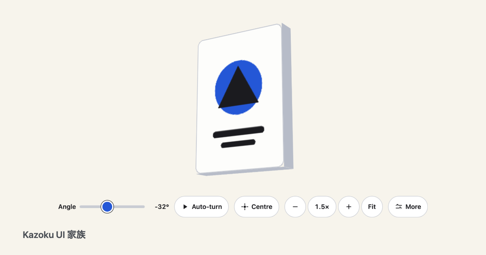
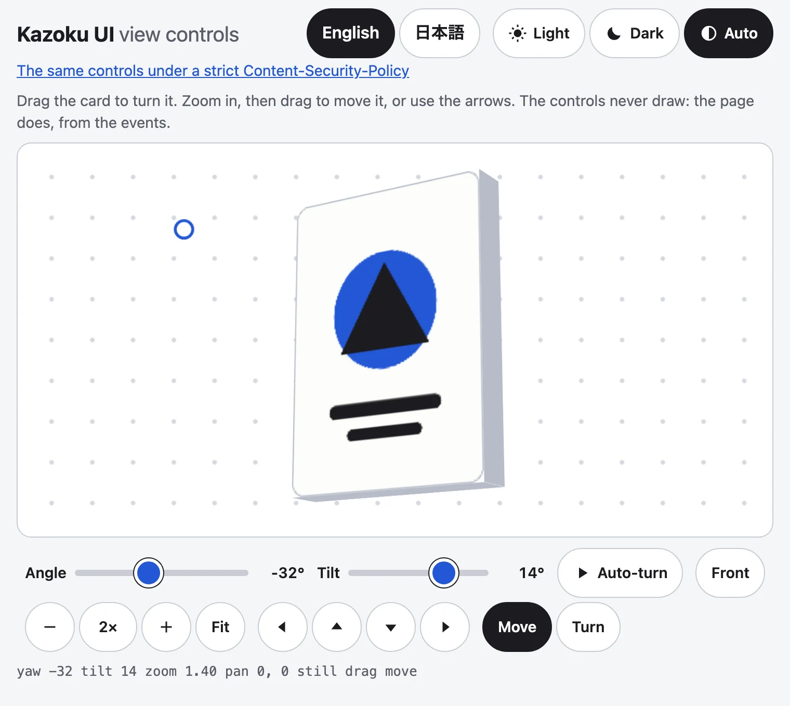
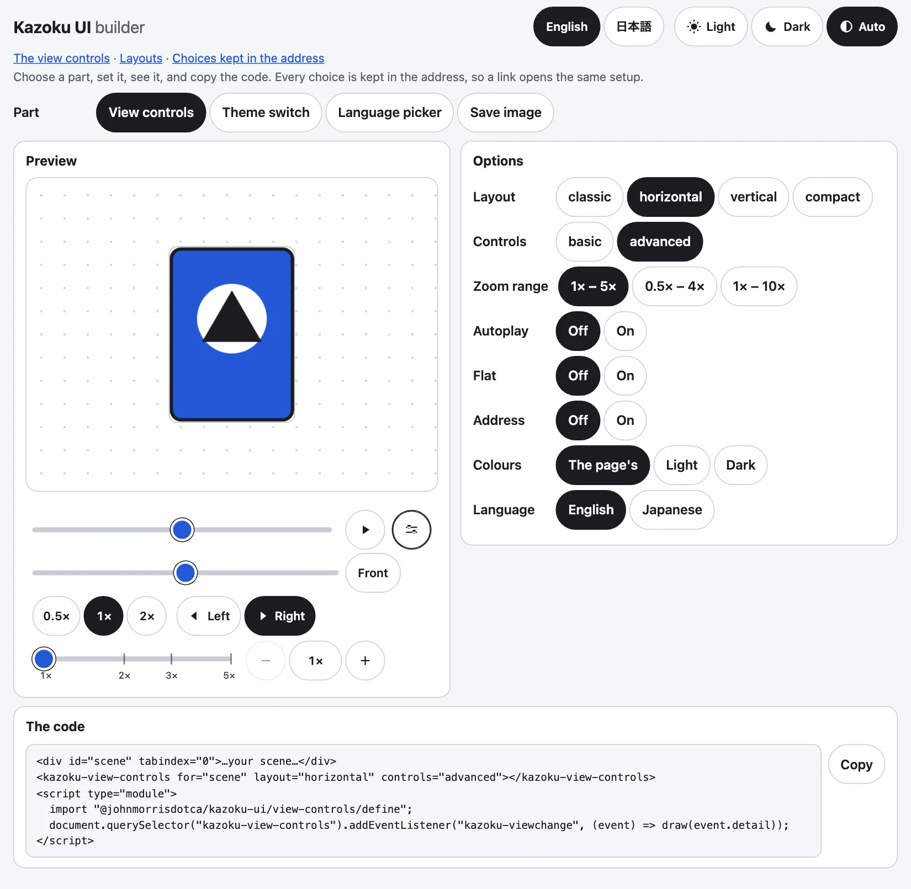

<p align="center"><a href="https://johnmorrisdotca.github.io/kazoku-ui/"><picture><source media="(prefers-color-scheme: dark)" srcset="https://raw.githubusercontent.com/johnmorrisdotca/kazoku-ui/main/docs/images/thumbnail-dark.png"></picture></a></p>

# Kazoku UI 家族

<picture>
<source media="(prefers-color-scheme: dark)" srcset="https://raw.githubusercontent.com/johnmorrisdotca/kazoku-ui/main/docs/images/hero-dark.webp">

</picture>

The family's shared interface parts, as their own versioned package: one part per subpath, so a page loads only what it uses. No runtime dependencies, MIT.
The first part is the **view controls** for any 3D or zoomable view. They never draw the scene: they tell your page what the reader chose, and your canvas, WebGL,
SVG or CSS 3D applies it.

[Demo](https://johnmorrisdotca.github.io/kazoku-ui/) · [Layouts demo](https://johnmorrisdotca.github.io/kazoku-ui/layouts.html) · [Strict-CSP demo](https://johnmorrisdotca.github.io/kazoku-ui/csp.html) · [Theme switch](docs/theme-switch.md) · [Language picker](docs/language-picker.md) · [Address state](docs/address-state.md) · [Save image](docs/save-image.md) · [Shared 3D renderer](docs/renderer.md) · [The drag rule](docs/drag-rule.md) · [Content-Security-Policy](docs/csp.md) · [Labels, English and 日本語](docs/labels.md) · [Changelog](CHANGELOG.md) · [Builder](https://johnmorrisdotca.github.io/kazoku-ui/builder.html) · [API reference](https://github.com/johnmorrisdotca/kazoku-ui/blob/main/docs/API.md) · [Guides](https://github.com/johnmorrisdotca/kazoku-ui/blob/main/docs/guides)

## In 30 seconds

```sh
npm install @johnmorrisdotca/kazoku-ui
```

```html
<div id="scene" tabindex="0" style="height: 200px">Your scene</div>
<kazoku-view-controls for="scene" address></kazoku-view-controls>
<script type="module">
  import "@johnmorrisdotca/kazoku-ui/view-controls/define";

  document.querySelector("kazoku-view-controls").addEventListener("kazoku-viewchange", (event) => {
    const { yaw, tilt, zoom, panX, panY } = event.detail;
    document.getElementById("scene").style.transform = `translate(${panX}px, ${panY}px) scale(${zoom}) rotateX(${tilt}deg) rotateY(${yaw}deg)`;
  });
</script>
```

And the pure functions, with no page at all:

```js
import { formatAddress, parseAddress, zoomMarks, zoomText } from "@johnmorrisdotca/kazoku-ui/view-controls";

console.log(formatAddress("?x=1", { yaw: 40, tilt: 10, zoom: 2, drag: "turn" })); // ?x=1&yaw=40&tilt=10&zoom=2&drag=turn
console.log(JSON.stringify(parseAddress("?yaw=40&zoom=2"))); // {"yaw":40,"zoom":2}
console.log(zoomMarks(1, 5).map((mark) => mark.zoom).join(" ")); // 1 2 3 5
console.log(zoomText(2.44)); // 2.4×
```

## Who it is for

- A page or a package that shows a 3D or zoomable view (a card, a globe, a rocket, a map) and wants the reader to turn, tip, zoom and move it, without writing the controls again.
- A site with a language choice and a Light, Dark or Auto switch that should look and behave the same across every page and every package of a family.
- A page that wants Save PNG and Save SVG for a canvas, an SVG or a piece of the page.
- A page of many 3D views that must stay inside one WebGL context and a pixel budget.
- A framework app: the parts are plain custom elements with plain modules beside them.

## Features

- **No runtime dependencies, one part to a subpath.** A page loads only what it uses.
- **View controls** in four layouts, with a zoom slider, a readout, Auto-turn, Centre, keys, touch and the address.
- **Theme switch** (Light, Dark, Auto) and **language picker** (each language in its own name) that write `data-theme` and `lang` and tell the page.
- **Save image** for a canvas, an SVG or any element, as PNG or SVG.
- **Address state**, with no element: choices kept in the link with `replaceState`.
- **A shared 3D renderer** and its **freeze checks**: one WebGL context, shared assets, stills, a pixel budget.
- **Labels in English and Japanese**, light and dark, 48 px touch targets, reduced motion respected.
- **A strict Content-Security-Policy is fine:** styles are adopted as constructable stylesheets.

## Install

```sh
npm install @johnmorrisdotca/kazoku-ui
```

```sh
pnpm add @johnmorrisdotca/kazoku-ui
```

Node 22 or later builds and tests it; the parts run in any current browser. Each part is its own subpath, and the `define` file of an element registers its tag, once, and only if the tag is free.

## Use it in your project

In a bundler or a framework, import the `define` file of each element you use once, in code that runs in the browser, and import the pure modules wherever you like:

```ts no-run
import "@johnmorrisdotca/kazoku-ui/view-controls/define";
import "@johnmorrisdotca/kazoku-ui/theme-switch/define";
import { createAddressState } from "@johnmorrisdotca/kazoku-ui/address-state";
import type { ViewChangeDetail } from "@johnmorrisdotca/kazoku-ui/view-controls/element";

export const state = createAddressState({ defaults: { size: "m" } });
export const draw = (detail: ViewChangeDetail) => console.log(detail.yaw, detail.zoom);
```

## Use it anywhere

On a page with no bundler, an import map tells the browser where each subpath lives, and the `dist` folder is served as it is:

```html
<script type="importmap">
{ "imports": {
  "@johnmorrisdotca/kazoku-ui/theme-switch/define": "/node_modules/@johnmorrisdotca/kazoku-ui/dist/theme-switch/define.js"
} }
</script>
<kazoku-theme-switch address storage></kazoku-theme-switch>
<script type="module">import "@johnmorrisdotca/kazoku-ui/theme-switch/define";</script>
```

## Examples

A theme switch and a language picker side by side, with the page answering their events:

```html
<kazoku-theme-switch address storage></kazoku-theme-switch>
<kazoku-language-picker languages="en ja" address storage></kazoku-language-picker>
<script type="module">
  import "@johnmorrisdotca/kazoku-ui/theme-switch/define";
  import "@johnmorrisdotca/kazoku-ui/language-picker/define";

  document.addEventListener("kazoku-themechange", ({ detail }) => console.log(detail.choice, detail.scheme));
  document.addEventListener("kazoku-languagechange", ({ detail }) => console.log(detail.lang));
</script>
```

Save a canvas as a PNG:

```html
<canvas id="art" width="360" height="200"></canvas>
<kazoku-save-image for="art" name="my-picture"></kazoku-save-image>
<script type="module">import "@johnmorrisdotca/kazoku-ui/save-image/define";</script>
```

The same idea in code, with the address and the theme as plain functions:

```js
import { applyParams } from "@johnmorrisdotca/kazoku-ui/address-state";
import { resolveTheme } from "@johnmorrisdotca/kazoku-ui/theme-switch";
import { filenameFor } from "@johnmorrisdotca/kazoku-ui/save-image";

console.log(applyParams("?a=1&size=m", { size: "l", a: null }, { size: "m" })); // ?size=l
console.log(resolveTheme("auto", true)); // dark
console.log(filenameFor("My Card/x", "png")); // My Card-x.png
```

## Parts

Each its own subpath; later ones: picture-tile pickers, Help, GitHub and npm pills, the family's backgrounds.

| Subpath | What it is |
|---|---|
| `@johnmorrisdotca/kazoku-ui/view-controls` | The controller, the arithmetic, the address and the labels. Imports on a server. |
| `@johnmorrisdotca/kazoku-ui/view-controls/element` | The `ViewControlsElement` class (needs a browser). |
| `@johnmorrisdotca/kazoku-ui/view-controls/define` | Registers `<kazoku-view-controls>` (once, and only if the tag is free). |
| `@johnmorrisdotca/kazoku-ui/theme-switch` | The theme choices, how one is applied and remembered. Imports on a server. |
| `@johnmorrisdotca/kazoku-ui/theme-switch/element` | The `ThemeSwitchElement` class (needs a browser). |
| `@johnmorrisdotca/kazoku-ui/theme-switch/define` | Registers `<kazoku-theme-switch>` (once, and only if the tag is free). |
| `@johnmorrisdotca/kazoku-ui/language-picker` | The language codes, each language's own name, which one to start in, how one is applied. Imports on a server. |
| `@johnmorrisdotca/kazoku-ui/language-picker/element` | The `LanguagePickerElement` class (needs a browser). |
| `@johnmorrisdotca/kazoku-ui/language-picker/define` | Registers `<kazoku-language-picker>` (once, and only if the tag is free). |
| `@johnmorrisdotca/kazoku-ui/save-image` | The formats, the file name, the size and the functions that render and download a canvas, an SVG or an element as PNG or SVG. Imports on a server. |
| `@johnmorrisdotca/kazoku-ui/save-image/element` | The `SaveImageElement` class (needs a browser). |
| `@johnmorrisdotca/kazoku-ui/save-image/define` | Registers `<kazoku-save-image>` (once, and only if the tag is free). |
| `@johnmorrisdotca/kazoku-ui/renderer` | The shared 3D renderer: one WebGL context for the focused view, shared assets, stills, drawing on demand, a pixel budget. three.js is an optional peer, loaded by your `import("three")`. Imports on a server. |
| `@johnmorrisdotca/kazoku-ui/testing` | The freeze checks for a 3D package's e2e: count contexts, GPU objects, draws and frames; the canvas size against the budget. No test framework named. |
| `@johnmorrisdotca/kazoku-ui/address-state` | Choices kept in the address: read, write and subscribe to URL parameters with `replaceState`. No element; imports on a server. |

## View controls

- **Two levels, so the bar stays simple.** The default, `controls="basic"`, shows the angle slider, Auto-turn, zoom out and in with a **zoom readout** (`2.4×`; tap it to go back to Fit), Fit, and a small More button; while the view turns, one small **speed** button beside Auto-turn (it shows the word Speed over `Medium`, and a press steps to the next speed). More (or `controls="advanced"`) adds the tilt slider, all three speeds (Slow, Medium, Fast), Front, and, once zoomed in, the four-arrow pan pad and the Move or Turn choice for what a drag does. The reader's choice with More is remembered in `localStorage` and beats the attribute.
- The zoom readout is the view's `zoom` (1× is Fit, whatever `fit-scale` is), one decimal, the one zoom number on the bar: it follows the buttons, the wheel, a pinch, a double press, Fit, the keys, the address, `set` and a changed limit. A screen reader is told "Zoom level 2.4×" once the zoom has settled for a moment, not for every step of a pinch.
- Auto-turn with play and pause; its speed is Slow (half the `speed` attribute), Medium (the `speed` attribute, 30 degrees a second) or Fast (twice it), kept in the address as `?speed=slow` or `?speed=fast`.
- **The wheel zooms.** The wheel over the view zooms it about the pointer, like a map; a trackpad's pinch (and Ctrl or Command with the wheel) zooms too. Shift and the wheel, or a sideways swipe, turns it. Tipping is a drag, the arrow keys or the tilt slider. With the pointer anywhere else the wheel scrolls the page, and a wheel that starts while the zoom is already at its end that way (turned down at Fit) scrolls the page too, so the page is never trapped.
- Touch: one finger turns at 1x and moves the view when zoomed in; two fingers pinch.
- Keys on the view: arrows turn and tip it, `+` and `-` zoom, `0` or Home is Front and Fit.
- The choices are kept in the address, with keys you can rename.
- **Four layouts** (`layout`: classic, horizontal, vertical, compact) and a **zoom slider** with marks at 1×, 2× and the ends: see [Layouts](#layouts).
- Labels in English and Japanese; light and dark; 48 px touch targets; a compact bar on a phone; no automatic turn for a reader who prefers reduced motion.
- **A control never stops or resets the turn.** Zoom, tilt, pan, the Move or Turn choice, Fit and Front all leave Auto-turn running (Front only sets the angle to 0 and the turn goes on from there). A hand on the angle slider, or turning the view by dragging it, holds the turn still while it is down and the turn carries on from where the hand left it. Only the Auto-turn button pauses it.

### Layouts

<picture>
<source media="(prefers-color-scheme: dark)" srcset="https://raw.githubusercontent.com/johnmorrisdotca/kazoku-ui/main/docs/images/layouts-dark.webp">

</picture>

Try them on the [layouts demo](https://johnmorrisdotca.github.io/kazoku-ui/layouts.html): every layout live, side by side, each with its code to copy, and a choice of zoom range to see the slider's marks change.

The `layout` attribute says where the controls sit; `controls` (`basic` or `advanced`, and the reader's More) still says what is shown, the same in every layout. A page that names no layout keeps the bar it had.

| `layout` | What it looks like | Basic shows | More adds |
|---|---|---|---|
| `classic` (the default) | The bar of 0.10 and before, unchanged: one wrapping row at a desk, two rows on a phone. No zoom slider. | Angle, Auto-turn, − readout +, Fit, More | Tilt, Slow, Medium, Fast, Front; the pan pad once zoomed in |
| `horizontal` | A tidy bar under the view: the turn on one row (Angle, Auto-turn, More), the **zoom slider** on the next (Zoom, − readout +, Fit). One row when the bar is 1040 px or wider. Under 560 px the labels are read by a screen reader only, and the readout is Fit; under 440 px the zoom slider takes a row of its own, with the buttons under it, so its marks never meet them. Centre, once the view is zoomed or moved, comes in at the end of the zoom row (an icon in the two rows, so Auto-turn and More never move). | Angle, Auto-turn, the zoom slider, − readout +, Fit, More | Tilt and Front, then the speeds, between the two rows; the pan pad last |
| `vertical` | A column beside the view, `--kazoku-column-width` wide (16rem). Auto-turn and More at the top, so More does not move when it opens; then the Angle slider, the zoom slider, and − readout + and Fit. On a narrow screen put it under the view and give it `width: auto`. | Auto-turn, More, Angle, the zoom slider, − readout +, Fit | Tilt, the speeds, Front, the pan pad, in the column |
| `compact` | The least room, for a card or a phone: **one row** of Auto-turn, −, the readout, + and More (icons, named for a screen reader). It never takes a second row until More is pressed; while it turns, the speed is in More, and Centre is there with Fit. | Auto-turn, − readout +, More | Everything else, one press away, under the row: the zoom slider and Fit, Angle, Tilt, the speeds, Front, the pan pad |

```html no-check
<!-- Horizontal: under the view -->
<div id="view" tabindex="0">...your scene...</div>
<kazoku-view-controls for="view" layout="horizontal"></kazoku-view-controls>

<!-- Vertical: beside the view -->
<div style="display: flex; gap: 12px">
  <div id="view" tabindex="0" style="flex: 1">...your scene...</div>
  <kazoku-view-controls for="view" layout="vertical"></kazoku-view-controls>
</div>

<!-- Compact: one row; with overlay it floats over the bottom corner of a positioned card -->
<div style="position: relative">
  <div id="view" tabindex="0">...your scene...</div>
  <kazoku-view-controls for="view" layout="compact" overlay></kazoku-view-controls>
</div>
```

**The zoom slider** (horizontal, vertical and compact) runs from `zoom-min` to `zoom-max` on a logarithmic scale, so a press of − or + moves it the same distance anywhere along it. It has marks, labelled, at both ends and at the common zooms between them that have room for a label: 1× to 5× gives 1×, 2×, 3×, 5×; 0.5× to 4× gives 0.5×, 1×, 2×, 4×; 1× to 10× gives 1×, 2×, 4×, 10×. The readout beside it is the true zoom, and the slider always shows it too, whatever moved the view (the buttons, the wheel, a pinch, a double press, Fit, the keys on the view, the address, `set`, the limits). A drag or a press that ends within 8 px of a mark goes to it; anywhere else it stays where it was let go. − and + still step by 1.4×. Keys on the slider: the arrows step by 1.1× and stop on a mark they would pass, Page Up and Page Down go to the next mark, Home and End to the ends. A screen reader hears its value as the readout says it (`2.4×`), and its name is Zoom. Without the element, `zoomMarks(min, max)`, `zoomPosition`, `zoomAtPosition`, `zoomStep`, `zoomToMark` and `zoomSnap` are the same scale in `@johnmorrisdotca/kazoku-ui/view-controls`.

### In plain HTML

```html
<div id="scene" tabindex="0" style="height: 320px">...your scene...</div>
<kazoku-view-controls for="scene" address></kazoku-view-controls>

<script type="module">
  import "@johnmorrisdotca/kazoku-ui/view-controls/define";

  const scene = document.getElementById("scene");
  document.querySelector("kazoku-view-controls").addEventListener("kazoku-viewchange", (event) => {
    const { yaw, tilt, zoom, panX, panY } = event.detail;
    scene.style.transform = `translate(${panX}px, ${panY}px) scale(${zoom}) rotateX(${tilt}deg) rotateY(${yaw}deg)`;
  });
</script>
```

Put the element on the view or right beside it, so it is on screen with the view. `for` names the element the hands bind to (the pointer, pinch, wheel and keys); give it a `tabindex` if you want the keys on it, and size it to the view, because the pan is held to the room the zoom gives. With `overlay` the bar sits over the bottom of its positioned parent instead.

### In a framework

The element is plain DOM, so any framework uses it with a ref and one listener. React:

```jsx
import "@johnmorrisdotca/kazoku-ui/view-controls/define";
import { useEffect, useRef } from "react";

export function Viewer({ draw }) {
  const view = useRef(null);
  const controls = useRef(null);
  useEffect(() => {
    const bar = controls.current;
    bar.view = view.current;
    const on = (event) => draw(event.detail);
    bar.addEventListener("kazoku-viewchange", on);
    return () => bar.removeEventListener("kazoku-viewchange", on);
  }, [draw]);
  return (
    <>
      <div ref={view} tabIndex={0} style={{ height: 320 }} />
      <kazoku-view-controls ref={controls} lang="en" />
    </>
  );
}
```

### Without the element

`createViewController` is the same hands and state with no markup of its own, for a page that draws its own buttons. It touches the DOM only in `bind`.

```js no-run
import { createViewController } from "@johnmorrisdotca/kazoku-ui/view-controls";

const view = createViewController({
  speed: 30, // degrees a second for Auto-turn
  onChange(state, { final, reason }) {
    draw(state); // { yaw, tilt, zoom, panX, panY, turning, drag }
  },
});
const unbind = view.bind(document.getElementById("scene")); // pointer, pinch, wheel, keys
myPlayButton.onclick = () => view.toggle();
myZoomIn.onclick = () => view.zoomBy(1.4);
```

The automatic turn is idle whenever nothing can see the view: while the `for` element (else the controls) is scrolled out of sight, and while the tab is hidden. Its frame loop is stopped, so no animation frame is asked for and no `kazoku-viewchange` event with reason `auto` is sent; `state.turning` stays true, and the turn goes on from where it was when the view is back (the first frame back only restarts the clock). A view that opens off screen asks for no frame until it is seen, and an element on no page asks for none. One frame is asked for at a time, and at most one `auto` change is sent a page frame. A page does not need to pause it for these. Without the element, `view.bind(element)` watches the bound element the same way; `view.suspendTurn()` and `view.resumeTurn()` do the same for your own visibility test (they nest, on top of what `bind` does), and `view.play(seconds)` stops the turn by itself after that many seconds of turning.

Options of `createViewController` that match: `zoom` (`"fit"` or a number), `fitScale`, `ignore`, `anchor`, `keyTilt`, `stopTurn`, `tiltStep`, `grabRadius`. `anchor`, `keyTilt`, `stopTurn`, `tiltStep` and `grabRadius` are also members you can change at any time. The controller also has `ignore` (changeable), `fitScale`, `startZoom` (the `zoom` the view opens at) and `setFitScale(n)`, `setStartZoom(zoom)`; `DEFAULT_IGNORE` is the default selector.

### Buttons and links inside the view

The hands capture the pointer on the `for` element, so a press on a button or link placed inside it would be taken for a drag and its click lost. A press on anything that matches `ignore` is left alone (no capture, no drag, no double-tap), and the click goes through. Mark any other child with `data-kazoku-ignore`. Dragging from the empty part of the view turns it as before.

`ignore` also sees through shadow DOM: it tests every element on the event's path from the innermost one up to the view, so a button inside a web component's open shadow root (a card's own Animate button, say) is left alone even though the event's target is the component. A closed shadow root hides its inside from the page, so only the component itself can be matched: mark the host with `data-kazoku-ignore`, or add its tag name to `ignore`.

### Zooming about a point of your own

The zoom buttons and keys have no pointer, so they zoom about the view's middle. If your scene's middle is not the view's (a piece standing to one side, say), tell the controls where it is:

```js no-run
controls.anchor = { x: 60, y: -30 }; // pixels from the view's middle when it is at Fit
```

Zoom is about that point of the picture, so it stays put on screen however far in the reader is and wherever the view has been moved to: `+` then `-` leaves it where it was within a pixel. Without the element, set `view.anchor` on the controller, or pass `anchor` to `createViewController`; `view.zoomBy(f)` and `view.zoomAt(z)` with no point use it.

### Centre

Zoom in and drag the object away and a **Centre** button (中央) comes into the bar. It puts the object back in the middle at Fit and the default angle (yaw and tilt 0) with a quarter of a second's move, at once for a reader who prefers reduced motion, and a hand on the view (a press, the wheel, a key) stops the move where it is. `element.centre()` and `controller.centre(animate = true)` do the same from code, ending with a change whose `reason` is `"centre"`. The keys Home and 0 are the same without the move (they send `front` and `fit`). The pan is held so the object cannot be lost: the picture keeps covering the view, or, with `object-size`, a quarter of the object stays in view.

### The drag rule and exact grab

In every turnable view the surface under the pointer follows the pointer, the arrow keys agree, and Auto-turn goes the object's real way; `grab-radius` makes a drag keep the touched point under the pointer on a globe. The rule, the option and the shared browser check (`templates/e2e-ground.mjs`) are in [docs/drag-rule.md](docs/drag-rule.md); the demo's `grab.html` shows it.

### Keys, the wheel and the turn

The wheel over the view zooms it about the pointer, and the steps of one turn of the wheel or one swipe stay with the view even when the zoom reaches its end part-way through, so the page does not jump. A new turn of the wheel at that end scrolls the page. Shift and the wheel, or a sideways swipe, turns the view (on a flat view they are left to the page). Arrow Up tips like a drag up (`tilt` gets larger); `key-tilt="wheel"` makes it tip the other way (`tilt` gets smaller), the way the wheel turned up tipped the view before 0.13.0, and Arrow Down the other way. `stop-turn` stops the automatic turn when the reader takes hold of the view with a press, the wheel or a key (a `pause` event is sent first); the defaults keep it turning, and a button or slider never stops it. `tilt-step="1"` makes a drag give whole degrees of tilt.

### Opening at the scene's natural size

Zoom 1 is Fit, whatever size that is on the page. A page that draws its scene at `fitScale` (for example 0.4 of natural size when it fits the view) and wants to open at natural size sets `zoom="1"` and tells the controls the scale:

```js no-run
const controls = document.querySelector("kazoku-view-controls");
controls.setAttribute("zoom", "1"); // natural size
controls.setFitScale(measure()); // the scale the scene is drawn at when it fits, for example 0.4
// the event's zoom is now 2.5; draw at event.detail.zoom * controls.fitScale
```

`setFitScale` moves the view to the opening zoom for the new scale, unless the reader has already zoomed. Fit and the Fit key still go to zoom 1, and the address leaves a zoom out when it is the opening one. `zoom="fit"`, or no `zoom`, changes nothing from before.

## The event API

`kazoku-viewchange` is dispatched on the element (it bubbles and crosses shadow roots). `event.detail`, and the first argument of `onChange`, is:

| Field | Meaning |
|---|---|
| `yaw` | Degrees, -180 up to 180: the turn about the vertical. Dragging right makes it larger. |
| `tilt` | Degrees, held to plus or minus `tilt-max` (30): the top tips away as it gets larger (dragging up). |
| `zoom` | 1 to 5 (`zoom-min`, `zoom-max`): 1 is Fit. The scene is drawn at `zoom * fitScale` (see below). |
| `panX`, `panY` | CSS pixels the zoomed picture is moved from the middle of the view; 0 at 1x. |
| `turning` | True while Auto-turn is running. |
| `drag` | `"move"` or `"turn"`: what a plain drag does while zoomed in. |
| `final` | False for the steps of a drag, a pinch, a slider and the automatic turn; true when something settled. Do the costly drawing on `final`, the cheap transform on every event. |
| `reason` | What changed it: `init`, `auto`, `drag`, `pinch`, `wheel`, `key`, `slider`, `zoom`, `pan`, `front`, `fit`, `fit-scale`, `play`, `pause` or `set`. |

An `init` event is sent once, a moment after the element connects, with the starting view (from the attributes and the address). `element.state` is the current view at any time.

### Attributes

| Attribute | |
|---|---|
| `for` | The id of the view the hands bind to. Or set `element.view = someElement`. |
| `lang` | `en` or `ja`. Otherwise the nearest `lang` above it, else English. |
| `yaw`, `tilt` | The starting angle and tilt. |
| `zoom` | The starting zoom: `fit` (the default) or a number, a scale where 1 is the scene's natural size. It opens at that number divided by `fit-scale`; with `fit-scale` left at 1 it is the `zoom` of the event. |
| `fit-scale` | The scale your page draws the scene at when it is at Fit (event `zoom` 1): what zoom 1 means. 1 by default. Or call `element.setFitScale(n)` once the scene is measured. |
| `ignore` | A CSS selector for what inside the view a pointer press leaves alone, so its click goes through: `button, a, input, select, textarea, label, [data-kazoku-ignore]` by default. A bare `ignore=""` leaves nothing alone. |
| `anchor` | `x,y`: the point the + and - buttons, the 2x button and the + and - keys zoom about, in CSS pixels from the middle of the view when it is at Fit (zoom 1, no pan). It is a point on the picture, so it moves with it and stays fixed on screen while the buttons zoom. Left out, they zoom about the view's middle, as before. The wheel, a pinch and a double tap still zoom about the pointer. Or set `element.anchor = { x, y }` (`undefined` clears it). |
| `key-tilt` | Which way Arrow Up tips the view: `drag` (the default: like a drag up) or `wheel` (the other way, as the wheel turned up tipped it before 0.13.0; the wheel zooms now). Arrow Down goes the other way from Up. |
| `stop-turn` | A press on the view, the wheel over it or a key it handles stops the automatic turn. Off by default, so the turn carries on. Buttons and sliders never stop it. |
| `tilt-step` | Round the tilt of a drag to a multiple of this many degrees (`1` gives whole degrees). 0 by default: not rounded. |
| `object-size` | `w,h`: the object's size at Fit in CSS pixels, when it is smaller than the view. A pan then keeps at least a quarter of the object in view, however far it is dragged; left out, the object is the picture, which keeps covering the view. Or set `element.objectSize = { width, height }`. |
| `grab-radius` | Exact grab, for a globe or any turnable piece: its on-screen radius in CSS pixels at Fit, or `fit` for half the smaller side of the view. A drag then turns it by the angle that keeps the touched point under the pointer (a drag of *d* pixels moves the ground at the middle by *d* pixels), and the radius grows with the zoom. Left out, a drag turns by a fixed angle across the view, as before. See [docs/drag-rule.md](docs/drag-rule.md). |
| `autoplay` | Turn by itself from the start, unless the reader prefers reduced motion. |
| `autoplay-for` | Seconds of turning after which the `autoplay` turn stops by itself (as Auto-turn pressed). Left out, it never stops. Time spent paused off screen or in a hidden tab is not counted, and a reader's own Auto-turn press has no limit. |
| `speed` | Degrees a second at Medium (30); Slow is half and Fast twice. |
| `controls` | `basic` (the default) or `advanced`: which controls are shown (see above; the zoom readout in both, the speed in both while the view turns). Written in the page's markup it is where the reader starts; what the reader chose with More is remembered under `kazoku-view-controls` in `localStorage` (or the key `storage` names) and wins. Setting the attribute later changes the level at once. The host carries `data-level` with the level now. |
| `layout` | `classic` (the default), `horizontal`, `vertical` or `compact`: where the controls sit (see [Layouts](#layouts)). Can change at any time. Anything else is `classic`. The host carries `data-layout` with the layout in use. |
| `storage` | The `localStorage` key the level is remembered under (`kazoku-view-controls`). |
| `flat` | The view cannot turn: no angle, tilt, Auto-turn or Front, and a drag moves it. |
| `tilt-max`, `zoom-min`, `zoom-max` | The limits (30, 1, 5). |
| `address` | Keep the choices in the page's address (`?yaw=40&tilt=10&zoom=2&drag=turn&speed=fast`). |
| `address-keys` | Other keys: `yaw:a,zoom:z`. |
| `theme` | `light` or `dark`; otherwise the page's colour scheme. |
| `overlay` | Sit over the bottom of a positioned parent. With `layout="compact"` the row floats 8 px in from the bottom start corner instead of spanning the bottom. |

Methods: `play()`, `pause()`, `front()`, `fit()`, `set({ yaw, tilt, zoom, panX, panY, drag })`, `setFitScale(n)`, and `controller` (the `createViewController` object behind it). `element.words = { front: "Home" }` replaces labels.
Colours are custom properties: `--kazoku-ink`, `--kazoku-surface`, `--kazoku-line`, `--kazoku-accent`; the parts are `bar`, `field`, `slider` and `button`, and the zoom slider's `zoom-slider` (on its field and its input).

### The address

Only what a reader chose is kept: angle, tilt, zoom, the drag choice and the auto-turn speed (`speed=slow` or `speed=fast`; Medium leaves the address, and another value of `speed`, a page's own, is left alone). The pan is in pixels of one screen and the turning is of a moment, so neither is; while the view turns by itself the angle is left out. A value at its start (Fit, or the `zoom` the page opens at) leaves the address, and other parameters are kept. The address is written at most four times a second (Safari stops a page that changes its address more than 100 times in 30 seconds). Without the element: `parseAddress(search, keys?)` and `formatAddress(search, choices, keys?, leaveYaw?, startZoom?)`.

### Why the tag is only defined when it is free

`customElements.define` throws when a name is taken, and a page can meet that without any fault: two copies of this package (an app and a widget that each bundle one, or two versions), the script loaded twice, or a page that registered the tag to supply its own element. A throw would stop the importing module and the page's script with it. So `define` calls `customElements.get` first and the first definition wins; `defineViewControls(registry?)` returns whether it defined the tag.

## Theme switch

`<kazoku-theme-switch>` is Light, Dark and Auto as one row of 48 px buttons. It writes `data-theme` on the page's `<html>` (or a `target` you name; Auto takes it off, so the device decides), keeps the choice in the address (`address`) and optionally in `localStorage` (`storage`), and sends `kazoku-themechange`.

```html
<kazoku-theme-switch address storage></kazoku-theme-switch>
<script type="module">import "@johnmorrisdotca/kazoku-ui/theme-switch/define";</script>
```

The attributes, the event, the early-apply function for a server or a head script and the CSS to write are in [docs/theme-switch.md](docs/theme-switch.md). The demo has one in its header.

## Language picker

`<kazoku-language-picker languages="en ja">` is a button for each language the page lists, each in its own name (English, 日本語). It writes `lang` on the page's `<html>` (or a `target`), keeps the choice in the address (`address`, `?lang=ja`) and optionally in `localStorage` (`storage`), and sends `kazoku-languagechange` with `{ lang, previous, reason, target }`. It starts in the address' language, then the remembered one, then the page's `value`, then the reader's browser languages, then the first code. It translates nothing; the page answers the event.

```html
<kazoku-language-picker languages="en ja" address storage></kazoku-language-picker>
<script type="module">import "@johnmorrisdotca/kazoku-ui/language-picker/define";</script>
```

See [docs/language-picker.md](docs/language-picker.md). The demo's own English and 日本語 choice is one.

## Address state

Choices kept in the address, without an element: `createAddressState({ defaults })` with `get`, `set`, `remove`, `subscribe` and `flush`, writing with `replaceState` (no history entry, one write for the changes of a quarter of a second, a value at its default leaves the address, other parameters and the hash kept), and hearing back and forward. The theme switch, the language picker and the view controls keep their choices through it.

```js no-run
import { createAddressState } from "@johnmorrisdotca/kazoku-ui/address-state";

const state = createAddressState({ defaults: { size: "m" } });
state.set("size", "l"); // ?size=l
state.subscribe(({ key, value }) => redraw(key, value));
```

See [docs/address-state.md](docs/address-state.md); the demo's `address.html` shows it.

## Save image

`<kazoku-save-image for="art">` is Save PNG and Save SVG for a canvas, an SVG or any element: a canvas at its own pixel size; an SVG as a stand-alone SVG (the styles it is drawn in written into it) or a PNG at `scale` (2 by default); any other element as a PNG, drawn with its computed styles. `name` is the file name, `background` the colour behind a PNG, `manual` makes the picture and the `kazoku-save` event (`{ blob, format, width, height, filename, reason }`) but downloads nothing. `kazoku-saveerror` says why it could not.

```html
<kazoku-save-image for="jersey" name="senshu-jersey"></kazoku-save-image>
<script type="module">import "@johnmorrisdotca/kazoku-ui/save-image/define";</script>
```

What a picture of an element cannot carry (web fonts, `::before`, cross-origin images), the element-free `renderImage` and `saveImage`, and the one `img-src data:` a strict policy needs are in [docs/save-image.md](docs/save-image.md); the demo's `save-image.html` saves all three kinds.

## Shared 3D renderer

A page with many 3D views gets one WebGL context, handed to the focused view; the others are stills made once from the same renderer, kept in a budgeted list. Shared geometries,
materials, textures and models are counted and freed when the last view lets go. Nothing is drawn while the page rests or the view is out of sight, one animation frame is
requested at a time, and a canvas never passes 6 million pixels or 4096 a side. Context loss is handled in one place. **three.js is a peer dependency and is never bundled**:
your page passes `load: () => import("three")`, so it loads only when the first view goes live. How a package uses it, the API and the freeze checks: [docs/renderer.md](docs/renderer.md). Demo: `renderer.html`.

```ts no-check
import { createSharedRenderer } from "@johnmorrisdotca/kazoku-ui/renderer";
const renderer = createSharedRenderer({ load: () => import("three") });
const view = renderer.view(host, item);   // item: { key, build({ three, assets, width, height }) => { scene, camera } }
host.addEventListener("focus", () => view.focus());
```

## One release workflow for the family's packages

`.github/workflows/reusable-release.yml` is the release written once: from main, the tag must equal `package.json`'s version, the repo's check script runs, a version already on npm is skipped, the `v<version>` tag is made if missing, and `npm publish --provenance` runs by trusted publishing (no token). A package repo's `release.yml` calls it:

```yaml
jobs:
  release:
    uses: johnmorrisdotca/kazoku-ui/.github/workflows/reusable-release.yml@v0.7.2
```

npm accepts a called workflow: the trusted-publisher entry on npmjs.com names the **calling** file (`release.yml`), and `id-token: write` goes on both. To move a repo over, keep its file name `release.yml`, replace the body with the call, and pin to a released tag. The inputs, the sources and the steps are in [docs/release-workflow.md](docs/release-workflow.md).

## One AGENTS.md for the family's package repos

`templates/AGENTS.md` is the agent-instruction file every package repo can start from: the family rules (read spx-stats `docs/package-work.md` first, the board and ticket prefix, ports, checks, release, hand-off) above a marker, and the repo's own facts below it. See [docs/agents-template.md](docs/agents-template.md).

## Content-Security-Policy

The styles are adopted as a constructable stylesheet (`adoptedStyleSheets`), so a page with `style-src 'self'` and no `'unsafe-inline'` needs no hash and no allowance. A browser without it gets a `<style>` carrying the element's `nonce`. What a page needs is in [docs/csp.md](docs/csp.md), and the demo's `csp.html` runs under a strict policy.

## Size

Gzipped, unbundled. View controls: the element and its definition about 9.3 KB, the controller 5.0 KB, the sight watch 0.6 KB, the maths 2.1 KB, the address 1.4 KB, the levels and layouts 0.6 KB, the zoom scale 1.5 KB, the labels 0.9 KB and the styles 4.0 KB (the four layouts and the slider). Theme switch: the element and its definition 3.3 KB, the choices 1.0 KB, the labels 0.3 KB and the styles 0.3 KB. Language picker: the element and its definition 2.8 KB, the codes and names 1.7 KB, the labels 0.3 KB. Save image: the element and its definition 3.0 KB, the rendering 3.6 KB, the formats and file names 1.0 KB, the labels 0.4 KB. Address state: 2.1 KB. Shared 3D renderer: 8.9 KB (the renderer 4.5, the scheduler 1.2, the assets 1.4, the stills 0.6, the pixel budget 0.8, the index 0.4), the test kit 1.6 KB; three.js is the page's own and is not counted. Shared by parts: the style adoption 0.8 KB, the base styles 1.0 KB, the page's colours 0.5 KB and the target and the store 0.6 KB. `pnpm test:package` prints them. Nothing is loaded from the network.

## Checks

`pnpm check` (lint, types, 122 unit tests of the maths, the address, the controller and the package, the build and the packed package), and `pnpm test:demo` (the demo in Chromium and WebKit at a phone's width and a desk's: the controls in the first screen, a toggle during Auto-turn leaves the angle advancing, the frame loop counted at `requestAnimationFrame` (nothing out of sight or hidden, one callback a page frame otherwise, a moved element too), the zoom readout against the state after every way of zooming, the speed button adding no row, each layout's controls, rows and sizes (compact one row on a phone, turning adding no row), the zoom slider by keys, mouse and touch, its marks for several ranges and always the true zoom, the layouts page, a button or link inside the view still clicks while a drag turns it, the opening zoom and fit scale, zoom about the pointer, zoom about an anchor (`?anchor=pin`), Arrow Up either way (`?key-tilt=wheel`), `?stop-turn`, `?tilt-step=1`, pan when zoomed, touch, the address, the labels, reduced motion, the controls styled under a strict `style-src` with no violation, `demo/csp.html`, the theme switch and the language picker in each browser and size, the address state, back and forward and no history added, on `demo/address.html`, and the save buttons: each file read back from disk, on `demo/save-image.html`, and the shared 3D renderer on `demo/renderer.html`: one WebGL context over fifty focus changes, nothing drawn or requested at rest, the GPU objects and heap flat, the canvas within budget at 5K, context loss, out of sight, the stills' byte budget, and three.js fetched only when a view goes live).

## Theming

Every part follows the page's colours: `data-theme="light"` or `"dark"` on the page forces them, and without it the device decides. `theme="light"` or `theme="dark"` on one element gives it a look of its own. The colours are custom properties on the element: `--kazoku-ink`, `--kazoku-surface`, `--kazoku-line` and `--kazoku-accent`; the parts are `bar`, `field`, `slider` and `button` (and `group` for the others).

```html
<style>
  kazoku-theme-switch, kazoku-language-picker { --kazoku-accent: #2457d6; --kazoku-line: #c9cdd6; }
</style>
<kazoku-theme-switch></kazoku-theme-switch>
<script type="module">import "@johnmorrisdotca/kazoku-ui/theme-switch/define";</script>
```

## Accessibility

Controls are on or right beside the view and visible without scrolling; changing a control never stops or resets the turn; every control is 48 px; the choices are radio groups with one tab stop and the arrow keys; the zoom is announced politely once it has settled; each language button carries its own `lang`; reduced motion gets no automatic turn. The rules and the labels are in [Accessibility and labels](https://github.com/johnmorrisdotca/kazoku-ui/blob/main/docs/guides/accessibility-and-labels.md).

## Limits

- **The Japanese labels have not yet been read by a native speaker.**
- **The demo's scene is a CSS 3D card;** the package has no opinion about what draws.
- **A picture of an element** (save image) cannot carry web fonts, `::before` or `::after`, or a cross-origin image: draw those into a canvas and save the canvas.
- **Several visible live 3D views at once are not supported** by the shared renderer: that is its point.
- **WebKit has no software GL switch,** so off CI its tests skip the pages that draw WebGL.
- **Early development (0.x):** a minor version can add to the interface. [Upgrading](https://github.com/johnmorrisdotca/kazoku-ui/blob/main/docs/guides/upgrading.md) lists what asks something of you.

## Browser and runtime support

The elements need custom elements, shadow DOM and constructable stylesheets (Chrome, Edge, Firefox and Safari 16.4 or later; older Safari falls back to a `<style>` that carries the element's `nonce`). The demo is played in Chromium and WebKit, at a phone's width and a desk's. Node 22 or later builds and tests it (22.18 or later to run the TypeScript tests directly); the pure modules import on a server. To load an element only where it can run:

```js no-run
if ("customElements" in window) {
  await import("@johnmorrisdotca/kazoku-ui/theme-switch/define");
}
```

## Languages

Every label is in English and in Japanese, and a unit test holds that every key is in both. `lang="ja"` (on the element or on a parent) chooses Japanese; anything else is English. Your own words go over either set: `element.words = { front: "Home" }`, or `wordsFor("ja", { front: "ホーム" })`. The language picker names each language in its own language. The guides have a Japanese page each, in [docs/guides/ja](https://github.com/johnmorrisdotca/kazoku-ui/blob/main/docs/guides/ja).

## Roadmap

Parts that arrive later: picture-tile pickers, Help, GitHub and npm pills and the family's backgrounds, each a new subpath that changes nothing that exists. Next for what is here: the Japanese labels read by a native speaker, and the family's other packages moving to the shared parts.

## Architecture

One part, one subpath; the pure code, the element and the registration are three files; a part never draws the page's scene; the shared internals (styles, adoption, scheme, store, target) are not exported. See the [architecture guide](https://github.com/johnmorrisdotca/kazoku-ui/blob/main/docs/guides/architecture.md).

## Demos

[The demo](https://johnmorrisdotca.github.io/kazoku-ui/) has the view controls, the language picker and the theme switch in its header. Beside it: [layouts](https://johnmorrisdotca.github.io/kazoku-ui/layouts.html), [the builder](https://johnmorrisdotca.github.io/kazoku-ui/builder.html), [address state](https://johnmorrisdotca.github.io/kazoku-ui/address.html), [save image](https://johnmorrisdotca.github.io/kazoku-ui/save-image.html), [the shared renderer](https://johnmorrisdotca.github.io/kazoku-ui/renderer.html), [exact grab](https://johnmorrisdotca.github.io/kazoku-ui/grab.html) and [a strict Content-Security-Policy](https://johnmorrisdotca.github.io/kazoku-ui/csp.html).

<picture>
<source media="(prefers-color-scheme: dark)" srcset="https://raw.githubusercontent.com/johnmorrisdotca/kazoku-ui/main/docs/images/builder-dark.webp">

</picture>

## Documentation

| Guide | What it covers |
|---|---|
| [Getting started](https://github.com/johnmorrisdotca/kazoku-ui/blob/main/docs/guides/getting-started.md) | The parts in a few minutes |
| [View controls](https://github.com/johnmorrisdotca/kazoku-ui/blob/main/docs/guides/view-controls.md) | Every attribute, the event, the keys, the address |
| [Layouts and the zoom slider](https://github.com/johnmorrisdotca/kazoku-ui/blob/main/docs/guides/layouts-and-zoom.md) | The four layouts and the slider's scale |
| [The view controller and its arithmetic](https://github.com/johnmorrisdotca/kazoku-ui/blob/main/docs/guides/view-controller.md) | The controller without the element |
| [Theme switch](https://github.com/johnmorrisdotca/kazoku-ui/blob/main/docs/guides/theme-switch.md) | Light, Dark and Auto |
| [Language picker](https://github.com/johnmorrisdotca/kazoku-ui/blob/main/docs/guides/language-picker.md) | Each language in its own name |
| [Address state](https://github.com/johnmorrisdotca/kazoku-ui/blob/main/docs/guides/address-state.md) | Choices kept in the link |
| [Save image](https://github.com/johnmorrisdotca/kazoku-ui/blob/main/docs/guides/save-image.md) | A canvas, an SVG or an element as a picture |
| [The shared renderer](https://github.com/johnmorrisdotca/kazoku-ui/blob/main/docs/guides/renderer.md) | One WebGL context, and the freeze checks |
| [Frameworks and CSP](https://github.com/johnmorrisdotca/kazoku-ui/blob/main/docs/guides/frameworks-and-csp.md) | React, Vue, Svelte, Angular, servers, strict policies |
| [Accessibility and labels](https://github.com/johnmorrisdotca/kazoku-ui/blob/main/docs/guides/accessibility-and-labels.md) | The rules and the words |
| [Architecture](https://github.com/johnmorrisdotca/kazoku-ui/blob/main/docs/guides/architecture.md) | The parts and the rules |
| [Troubleshooting and FAQ](https://github.com/johnmorrisdotca/kazoku-ui/blob/main/docs/guides/troubleshooting.md) | A bar that does nothing, an unknown tag |
| [Upgrading](https://github.com/johnmorrisdotca/kazoku-ui/blob/main/docs/guides/upgrading.md) | What each version asks of you |

Each guide has a Japanese page of the same name in [docs/guides/ja](https://github.com/johnmorrisdotca/kazoku-ui/blob/main/docs/guides/ja). The reference for every export is [docs/API.md](https://github.com/johnmorrisdotca/kazoku-ui/blob/main/docs/API.md), written from the built declarations. The repository's own notes: [theme switch](docs/theme-switch.md), [language picker](docs/language-picker.md), [address state](docs/address-state.md), [save image](docs/save-image.md), [renderer](docs/renderer.md), [the drag rule](docs/drag-rule.md), [CSP](docs/csp.md), [labels](docs/labels.md), [the package standard](docs/package-standard.md).

## Development

```sh
pnpm check          # lint, types, tests, the build and the packed package
pnpm test:package   # pack it as npm does, install it in an empty project, import every entry
pnpm test:demo      # build the demo and play it in Chromium and WebKit
pnpm test:readme    # every example of the README and the guides, run in Node and in a browser
pnpm docs:api       # rewrite docs/API.md from the built declarations
pnpm docs:check     # the reference is current, every guide has its Japanese page, every link and picture is there
pnpm screenshots    # the pictures of the README and the guides (docs/images)
pnpm dev            # the demo on http://127.0.0.1:8400/
```

## Contributing

See [CONTRIBUTING.md](CONTRIBUTING.md): no runtime dependencies, one part to a subpath, a part never draws the page's scene, labels in both languages, no marks, and tests for what you change. Add a line to `CHANGELOG.md` under **Unreleased** for a change a user would notice. `templates/` and `docs/package-standard.md` are what the family's other packages copy unchanged.

## Changes

Every release, dated, is in [CHANGELOG.md](CHANGELOG.md).

## Licence

MIT. No brand, league or sponsor mark is in this package.
