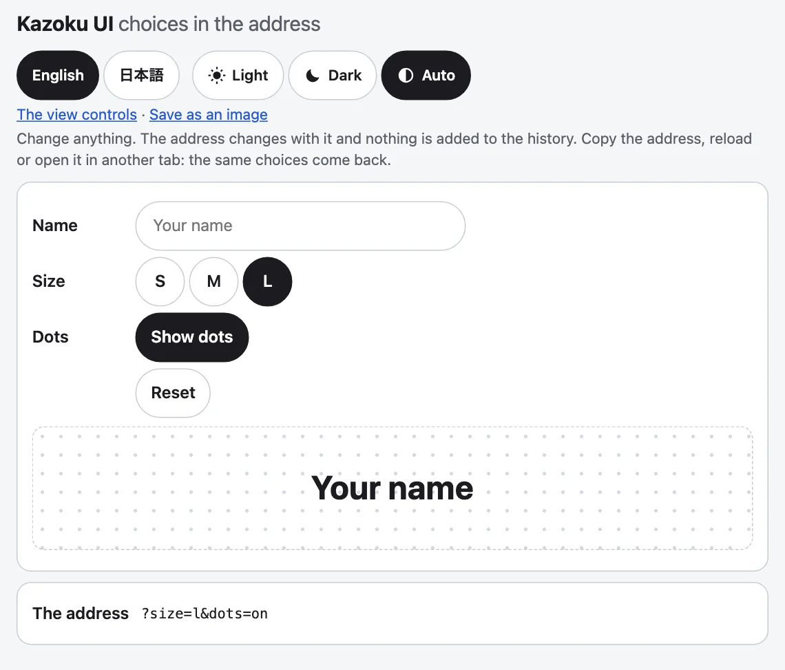

Address state reads, writes and watches URL parameters with `replaceState`, so a reload, a copied link or a second tab comes back to the same choices, and a choice adds nothing to the history. It has no element and no DOM at import, so it imports on a server. The theme switch, the language picker and the view controls keep their choices through it.



## Use it

In a page, `createAddressState` needs nothing. These examples hand it a stand-in for `window`, which is also how its own tests run:

```js
import { createAddressState } from "@johnmorrisdotca/kazoku-ui/address-state";

const where = { search: "?theme=dark&hash=kept", pathname: "/app", hash: "#top" };
const host = {
  location: where,
  history: { state: null, replaceState(_state, _unused, url) { where.search = url.includes("?") ? url.slice(url.indexOf("?"), url.includes("#") ? url.indexOf("#") : undefined) : ""; } },
};
const state = createAddressState({ defaults: { size: "m" }, delay: 0, host });
const heard = [];
state.subscribe(({ key, value, previous, source }) => heard.push(`${key}:${previous}>${value}:${source}`));

console.log(state.get("size"), state.get("theme"), state.has("size"), state.has("theme"));
state.set("size", "l");
console.log(where.search, state.get("size"));
state.set("size", "m");
console.log(where.search);
state.setMany({ name: "Ada", dots: 3 });
console.log(where.search, JSON.stringify(state.all()));
state.remove("name");
console.log(heard.join(" "));
state.destroy();
// m dark false true
// ?theme=dark&hash=kept&size=l l
// ?theme=dark&hash=kept
// ?theme=dark&hash=kept&name=Ada&dots=3 {"theme":"dark","hash":"kept","name":"Ada","dots":"3"}
// size:null>l:set size:l>null:set name:null>Ada:set dots:null>3:set name:Ada>null:set
```

## `createAddressState(options?)`

Options: `defaults` (a key's start: a value equal to it leaves the address, and `get` gives it when the address has none), `delay` (milliseconds a write waits, 250 by default, 0 writes at once) and `host` (a stand-in for `window`, for a test).

| Method | |
|---|---|
| `get(key)` | The value as the page will have it: a change still waiting counts, else the address, else the default, else `null`. |
| `has(key)` | Whether the address (or a change waiting) holds the key. |
| `all()` | Every parameter as `get` sees them. |
| `set(key, value)`, `setMany({ ... })`, `remove(key)` | A string or number sets; `null`, `undefined` or the default takes off. Subscribers hear it at once; the address is written after the delay. `setMany` is one write. |
| `subscribe(listener, keys?)` | Hears every change made through a state on this page and the reader going back or forward. `keys` limits it. Returns the function that stops it. |
| `flush()`, `destroy()` | Write what waits now; `destroy` also stops listening. |

A change is `{ key, value, previous, source }`: `value` and `previous` are what the address holds (`null` when the key is not there), and `source` is `set` or `navigation`. A change that sets what the address already holds is not announced.

## Writes

The address is written in place with `replaceState`, the path and the `#hash` kept and every other parameter left in its order. Changes inside the delay are one write, so a slider or a text box does not reach the hundred changes in thirty seconds after which Safari stops a page. A page that cannot change its address (a sandboxed frame) is left as it is, and nothing throws.

## Smaller pieces

The pure core is exported for a page that wants only the arithmetic:

```js
import { applyParams, createAddressWriter, readParam, readParams } from "@johnmorrisdotca/kazoku-ui/address-state";

console.log(JSON.stringify(readParams("?a=1&a=2&b=x")), readParam("b", "?a=1&b=x"), readParam("c", "?a=1"));
console.log(applyParams("?a=1&size=m", { size: "l", a: null }, { size: "m" }));
console.log(JSON.stringify(applyParams("?size=l", { size: "m" }, { size: "m" })));

const where = { search: "", pathname: "/", hash: "" };
const host = { location: where, history: { state: null, replaceState(_s, _u, url) { where.search = url.slice(url.indexOf("?")); } } };
const writer = createAddressWriter({ delay: 0, host });
writer.write((search) => applyParams(search, { zoom: 2 }));
console.log(where.search);
// {"a":"1","b":"x"} x null
// ?size=l
// ""
// ?zoom=2
```

- `readParams(search?)` and `readParam(key, search?)`: the parameters of an address; the first of a repeated one.
- `applyParams(search, changes, defaults?)`: a search string with the changes made (`?a=1` or an empty string), the pure core of every write.
- `createAddressWriter({ delay, host })`: `write(compute)`, `flush()`, `cancel()`. `compute` gets the search string when the write happens, and the latest of the calls inside the delay is the one that runs. The view controls write their address through this.

The types are `AddressState`, `AddressStateOptions`, `AddressChange`, `AddressValue`, `AddressHost`, `AddressWriter` and `AddressWriterOptions`; `AddressHost` is the part of `window` a stand-in needs: `location` and `history.replaceState`, with optional `popstate` listeners.

## In the family's parts

The element's own `address` attribute uses the same pieces, with its own keys: `?theme=`, `?lang=`, `?yaw=`, `?tilt=`, `?zoom=`, `?speed=`. Several parts on one page share the address and agree, because every state on the page hears every change. See [View controls](view-controls.md) for the view's keys and `address-keys` to rename them.
