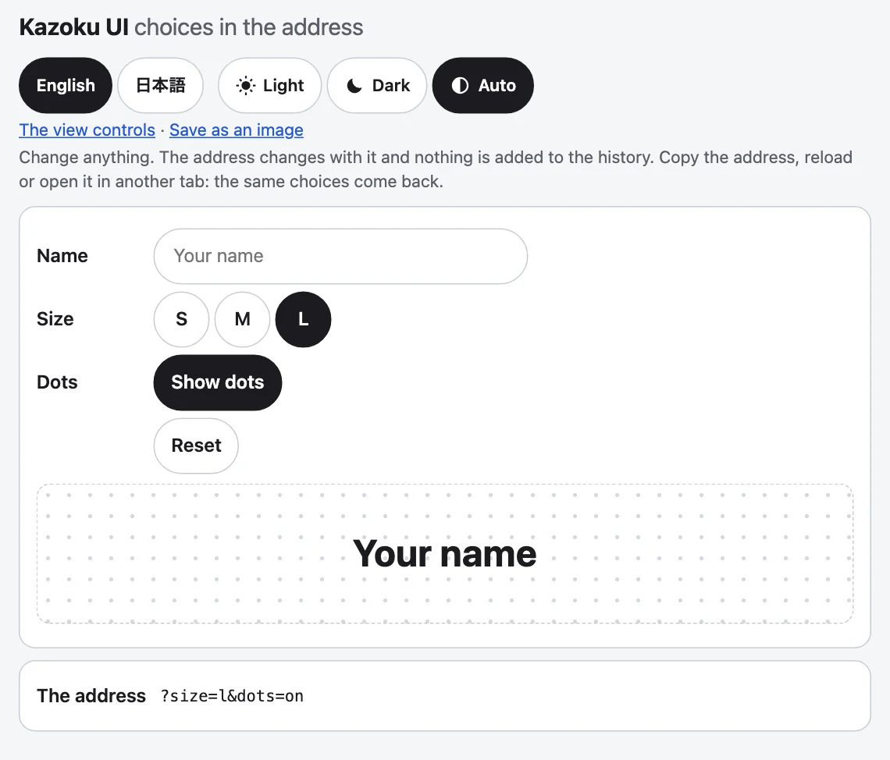

[English](../address-state.md)

アドレスの状態は、URLのパラメーターを`replaceState`で読み書きし、見張ります。再読み込みでも、コピーしたリンクでも、別のタブでも、同じ選択に戻り、選択で履歴が増えることもありません。要素はなく、インポート時にDOMも要らないので、サーバーでもインポートできます。テーマの切り替え、言語の選択、表示の操作は、これを通して選択を残します。



## 使い方

ページでは、`createAddressState`に何も渡す必要はありません。この例では`window`の代わりを渡しています。これは、このパッケージ自身のテストが動く方法でもあります。

```js
import { createAddressState } from "@johnmorrisdotca/kazoku-ui/address-state";

const where = { search: "?theme=dark&hash=kept", pathname: "/app", hash: "#top" };
const host = {
  location: where,
  history: { state: null, replaceState(_state, _unused, url) { where.search = url.includes("?") ? url.slice(url.indexOf("?"), url.includes("#") ? url.indexOf("#") : undefined) : ""; } },
};
const state = createAddressState({ defaults: { size: "m" }, delay: 0, host });
const heard = [];
state.subscribe(({ key, value, previous, source }) => heard.push(`${key}:${previous}>${value}:${source}`));

console.log(state.get("size"), state.get("theme"), state.has("size"), state.has("theme"));
state.set("size", "l");
console.log(where.search, state.get("size"));
state.set("size", "m");
console.log(where.search);
state.setMany({ name: "Ada", dots: 3 });
console.log(where.search, JSON.stringify(state.all()));
state.remove("name");
console.log(heard.join(" "));
state.destroy();
// m dark false true
// ?theme=dark&hash=kept&size=l l
// ?theme=dark&hash=kept
// ?theme=dark&hash=kept&name=Ada&dots=3 {"theme":"dark","hash":"kept","name":"Ada","dots":"3"}
// size:null>l:set size:l>null:set name:null>Ada:set dots:null>3:set name:Ada>null:set
```

## `createAddressState(options?)`

オプション：`defaults`（キーの開始値。この値と同じ値はアドレスから外れ、アドレスになければ`get`がこれを返します）、`delay`（書き込みを待たせるミリ秒。既定は250、0ならすぐ書きます）、`host`（`window`の代わり。テスト用）。

| メソッド | |
|---|---|
| `get(key)` | ページが持つ値：待っている変更があればそれ、なければアドレス、なければ既定値、なければ`null`。 |
| `has(key)` | アドレス（または待っている変更）にそのキーがあるか。 |
| `all()` | `get`が見るとおりの、すべてのパラメーター。 |
| `set(key, value)`、`setMany({ ... })`、`remove(key)` | 文字列や数なら設定し、`null`、`undefined`、既定値なら外します。購ユーザーにはすぐ伝わり、アドレスは遅延のあとに書かれます。`setMany`は1回の書き込みです。 |
| `subscribe(listener, keys?)` | このページの状態を通したすべての変更と、ユーザーの戻る・進むを受け取ります。`keys`で絞れます。止める関数を返します。 |
| `flush()`、`destroy()` | 待っているものをすぐ書きます。`destroy`は待ち受けも止めます。 |

変更は`{ key, value, previous, source }`で、`value`と`previous`はアドレスが持っていた値（キーがなければ`null`）、`source`は`set`か`navigation`です。アドレスがすでに持っている値の設定は、通知されません。

## 書き込み

アドレスは`replaceState`でその場で書き換えられ、パスと`#hash`は保たれ、ほかのパラメーターは順序もそのままです。遅延の間の変更は1回の書き込みにまとまるので、スライダーやテキストボックスで、30秒に100回の変更に達してSafariがページを止めるようなことは起きません。アドレスを変えられないページ（サンドボックス化されたフレーム）は、そのままで、例外も投げません。

## 小さな部品

計算だけが欲しいページのために、副作用のない中核部分もエクスポートされています。

```js
import { applyParams, createAddressWriter, readParam, readParams } from "@johnmorrisdotca/kazoku-ui/address-state";

console.log(JSON.stringify(readParams("?a=1&a=2&b=x")), readParam("b", "?a=1&b=x"), readParam("c", "?a=1"));
console.log(applyParams("?a=1&size=m", { size: "l", a: null }, { size: "m" }));
console.log(JSON.stringify(applyParams("?size=l", { size: "m" }, { size: "m" })));

const where = { search: "", pathname: "/", hash: "" };
const host = { location: where, history: { state: null, replaceState(_s, _u, url) { where.search = url.slice(url.indexOf("?")); } } };
const writer = createAddressWriter({ delay: 0, host });
writer.write((search) => applyParams(search, { zoom: 2 }));
console.log(where.search);
// {"a":"1","b":"x"} x null
// ?size=l
// ""
// ?zoom=2
```

- `readParams(search?)`と`readParam(key, search?)`：アドレスのパラメーター。同じキーが繰り返されたときは最初のもの。
- `applyParams(search, changes, defaults?)`：変更を加えた検索文字列（`?a=1`か空文字列）。すべての書き込みの中核になる純粋な関数です。
- `createAddressWriter({ delay, host })`：`write(compute)`、`flush()`、`cancel()`。`compute`は、書き込みが起きるときの検索文字列を受け取り、遅延の間の呼び出しでは、最後のものだけが実行されます。表示の操作は、これを通してアドレスを書きます。

型は、`AddressState`、`AddressStateOptions`、`AddressChange`、`AddressValue`、`AddressHost`、`AddressWriter`、`AddressWriterOptions`です。`AddressHost`は、代わりを作るときに必要な`window`の部分で、`location`と`history.replaceState`、それに任意の`popstate`のリスナーです。

## ファミリーの部品の中で

要素の`address`属性は、同じ部品を、それぞれのキーで使います。`?theme=`、`?lang=`、`?yaw=`、`?tilt=`、`?zoom=`、`?drag=`、`?speed=`です。1ページの複数の部品は、同じアドレスを共有して一致します。ページ上のすべての状態が、すべての変更を聞くからです。ビューのキーと、名前を変える`address-keys`は、[表示の操作](view-controls.md)を参照してください。
