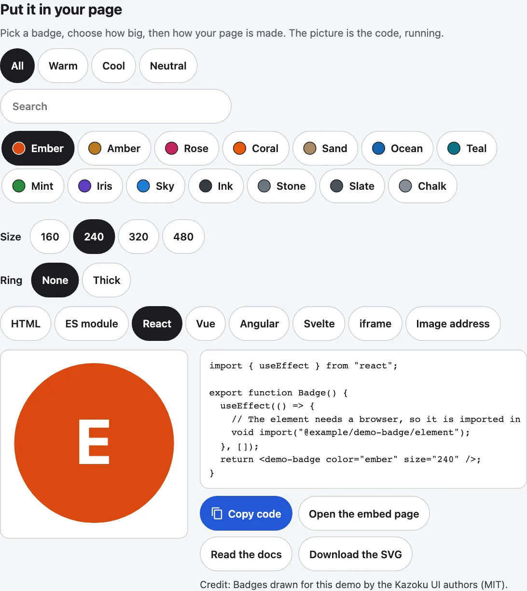

[English](../embed-panel.md)

`<kazoku-embed-panel>`は、ファミリー共通の「自分のページに入れる」パネルです。パッケージは、入れられるものの一覧、ページの作り方ごとのコード、そのコードが作る絵を渡します。まわりのものはパネルが受け持つので、どのパッケージでも同じ見た目、同じ言葉、同じ動きになります。パッケージ自身の絵は、パネルは描きません。



上から順に、中身はこうです。

- **小さな選択欄**: 入れるものを選びます。グループのチップ、検索ボックス (12個以上のとき)、枠の中でスクロールするボタンの一覧です。パッケージ独自の選択欄を`picker`スロットに入れることもできます。
- **大きさ**: ふつうは160、240、320、480ピクセルのボタンです。
- **パッケージ独自の選択**: `options`スロットに入ります。「回転」「見た目」「ふち」など、パッケージにもとからあったものは消えません。
- **ページの作り方ごとのタブ**: HTML (CDNのscriptタグ)、ESモジュール、React、Vue、Angular、Svelte、iframeです。画像のアドレスやSVGなど、タブを足すこともできます。
- **コードの横の絵**: 同じ選択から作られ、どの大きさでも、どの画面でも、枠に収まるように縮みます。
- **コピー**: 名前が書いてあるボタンです。押すと横に「コピーしました」と出ます。**埋め込みページを開く**と**ドキュメントを読む**もあります。`actions`スロットには、パッケージ独自のボタン (ダウンロード、PNG保存) を入れられます。
- **クレジット**: その絵に必要な出典の行です。

## 使い方

```html
<kazoku-embed-panel id="panel" kinds="html module react vue angular svelte iframe" open-href="embed.html" docs-href="docs/"></kazoku-embed-panel>
<script type="module">
  import "@johnmorrisdotca/kazoku-ui/embed-panel/define";
  import { embedSnippet } from "@johnmorrisdotca/kazoku-ui/embed-panel";

  const panel = document.getElementById("panel");
  const spec = (size, preview) => ({
    package: "@scope/dial",
    cdn: "https://cdn.jsdelivr.net/npm/@scope/dial@1.0.0",
    tag: "scope-dial",
    element: "element",
    entries: [],
    attrs: [["value", "7"], ...(size === 320 ? [] : [["size", String(size)]])],
    name: "dial",
    iframe: { src: `${preview ? "" : "https://example.com/dial/"}embed.html?value=7`, title: "Dial", width: size, height: size },
  });
  panel.generate = ({ kind, size, preview }) => embedSnippet(kind, spec(size, preview));
  panel.preview = ({ kind }) => {
    if (kind === "iframe") return undefined;
    const box = document.createElement("div");
    box.textContent = "7";
    box.style.cssText = "width: 100%; height: 100%; display: grid; place-items: center; font-size: 4rem";
    return box;
  };
  panel.credits = "Dial drawn by the package's author (MIT).";
</script>
```

`generate`は、パネルに必ず必要なものです。いま表示しているタブのコードを返します。`preview`は絵 (ノード) を返します。何も返さなければ、iframeのタブはそのコードのiframeを自分で描くので、パッケージが書くのは動いている絵だけで足ります。パッケージ自身の選択 (見た目、色、切り替え) が変わったら、`panel.update()`を呼んでください。パネルはすべてを読み直し、絵は、見せるものが変わったときだけ作り直します。

## ページの作り方ごとのコード

`embedSnippet(kind, spec)`は、要素の説明を1つ渡すと7つ全部のコードを書きます。パッケージが7つの生成コードを書く必要はありません。

| `kind` | 書かれるもの |
|---|---|
| `html` | 要素と各エントリを jsDelivr (`+esm`) から読む`<script type="module">`、そしてタグ。 |
| `module` | `import`の行、そして`document.createElement`で作った要素と、その属性の設定。 |
| `react` | 要素を effect の中で読み込み (ファイルの先頭では読まないので、サーバーの描画でも安全)、タグを返すコンポーネント。 |
| `vue` | `onMounted`の中で読み込む単一ファイルコンポーネント。 |
| `angular` | `CUSTOM_ELEMENTS_SCHEMA`を持ち、ブラウザの中でだけ読み込むスタンドアロンコンポーネント。 |
| `svelte` | `onMount`の中で読み込むコンポーネント。 |
| `iframe` | 選んだ大きさの`<iframe>`で包んだ埋め込みページ。遅延読み込みで、枠線なし。 |

`EMBED_KINDS`は、タブの並び順に7つを並べたものです。`SnippetSpec`は要素の説明です。`package`と`cdn` (バージョンつき)、`tag`、`element` (タグを定義するサブパス。メインのエントリなら空の文字)、`entries` (データや見た目のための、ほかのサブパス)、`attrs` (値が`""`なら値なしの属性)、`name` (`Dial`、`DialComponent`、`#dial`に使う名前)、`iframe`です。`attrText(attrs)`は、属性をタグの中の形に書きます。7つのどれでもないタブ (画像のアドレス、SVG) はパッケージ自身のものです。`kinds`にそのidを入れ、名前を`labels`に渡し、`generate`でそのコードを返します。

選択が要素の既定値のときは、コードに書きません (上のデモは、320のとき`size`を書きません)。コードが短くなり、あとで既定値が変わっても読む人に届きます。

**絵**のためのコード (`preview: true`) は、読む人がコピーするコードと違ってかまいません。絵のiframeのアドレスは相対にして (`embed.html?…`)、デモをどこから配信しても絵が動くようにし、コピーされるコードには完全なアドレスを使います。

## 小さな選択欄

```html
<kazoku-embed-panel id="things" no-preview no-size kinds="html"></kazoku-embed-panel>
<script type="module">
  import "@johnmorrisdotca/kazoku-ui/embed-panel/define";
  const panel = document.getElementById("things");
  panel.items = [
    { id: "mars", label: "Mars", group: "Planets" },
    { id: "deimos", label: "Deimos", group: "Moons", words: "moon of Mars" },
    { id: "sun", label: "Sun" },
  ];
  panel.generate = () => `<scope-dial thing="${panel.value}"></scope-dial>`;
  panel.addEventListener("kazoku-embedchange", ({ detail }) => console.log(detail.reason, detail.value));
</script>
```

`items`は`PickItem`の一覧です。`id`、`label`、任意の`group` (一覧の上のチップ。groupがないものは「すべて」の下だけ)、検索も読む任意の`words`があります。項目ごとにボタンが1つあり、`value`の項目は押された状態です。チップと検索は一覧を絞るだけで、何も選びません。ボタンを押すと、`value`とコードと絵が変わり、ページに伝わります (`reason: "pick"`)。検索は大文字小文字とアクセントを区別せず、入力した語がすべて含まれるものを探します。項目が12個 (`SEARCH_FROM`) 以上のときに出ます。`search`と`no-search`で上書きできます。`renderItem`を使うと、ボタンの中に小さな絵を入れられます。`filterItems`と`groupsOf`は、要素なしで使える同じ処理です。もっと凝った選択欄 (動くサムネイルつきのタイルなど) を持つパッケージは、それを`picker`スロットに入れて、そのまま使えます。

## パッケージ独自の選択とボタン

```html
<kazoku-embed-panel id="own" no-preview>
  <div slot="options"><button type="button" id="turn">Turning</button></div>
  <button slot="actions" type="button" id="save">Download the SVG</button>
</kazoku-embed-panel>
<script type="module">
  import "@johnmorrisdotca/kazoku-ui/embed-panel/define";
  const panel = document.getElementById("own");
  let turning = false;
  panel.generate = () => `<scope-dial${turning ? " turn" : ""}></scope-dial>`;
  document.getElementById("turn").addEventListener("click", () => {
    turning = !turning;
    panel.update();
  });
</script>
```

スロットのおかげで、共通パネルにする前にパッケージにあったものが残ります。`options`は大きさとタブのあいだに入ります (見た目、回転、ふちなどの選択。自分の状態を持つので、変わったら`update()`を呼びます)。`actions`はコピーの隣に入ります (SVG保存、PNG保存、ダウンロード)。`lede`は見出しの下の1行です。`picker`は組み込みの選択欄の代わりになります。表示中のタブのコードの上の1行 (「埋め込みページは、スクリプトを動かせないサイト向けです」など) は`note`で、文字か、選択を受け取る関数です。クレジットは`credits`で、同じく文字か関数です。

## 絵のないパッケージ

絵のないパッケージ (データの表、要素のない計算機) は、`no-preview`と`no-size`をつけ、意味のあるタブだけを`kinds="html module"`のように並べ、READMEにその旨を書きます。選択欄、コピー、ドキュメントへのリンク、クレジットは、そのまま使えます。描くものがないという理由で、パネルをデモから外すことはしません。

## 属性とプロパティ

| 属性 | |
|---|---|
| `kinds` | タブ。ふつうは`html module react vue angular svelte iframe`です。自分のid (`image`) を足せます。プロパティの`kinds`は、一覧か文字を受け取ります。 |
| `kind` | 最初に開くタブ (ふつうは先頭)。 |
| `sizes`、`size` | 大きさのボタン (16から4096までの整数、ふつうは`160 240 320 480`) と、最初の大きさ (320)。`no-size`で大きさの選択をなくします。ボタンにない大きさは、いちばん近いものになります。 |
| `value` | 選択欄の選び (項目の`id`)。読む人の選びに合わせて変わるので、属性はいつも正しい値です。 |
| `open-href`、`docs-href` | 「埋め込みページを開く」と「ドキュメントを読む」の行き先。空にするとそのボタンは隠れます。`panel.openHref`は選択に合わせて変えます (選択が変わったら設定してください)。 |
| `aspect` | 絵の高さ÷幅。ふつうは1です。 |
| `no-preview` | 絵を出しません。 |
| `heading` | 共通の見出し「自分のページに入れる」を出します。 |
| `search`、`no-search` | 選択欄の検索ボックスを、強制的に出す、または隠します。`pick-label`は選択欄の名前です。 |
| `address`、`kind-key`、`size-key` | タブと大きさをアドレスに残し (`?embed=react&size=240`。最初の状態はアドレスに出ません)、読み戻します。ほかのパラメータは残ります。 |
| `lang`、`theme` | `en`か`ja`。`light`か`dark`。指定がなければ、いちばん近い`lang`とページの色を使います。 |

プロパティは、`generate`、`preview`、`credits`、`note` (上で説明したもの)、`items`、`renderItem`、`labels` (ファミリーに言葉がないタブの名前)、`words` (言語の言葉の上に重ねる自分の言葉)、`kind`、`size`、`value`、`kinds`、`sizes`、`openHref`、`docsHref`、`code` (表示中のタブのコード)、`update()`です。タグが定義される前に設定したプロパティも、要素に届きます。色はファミリーのカスタムプロパティ (`--kazoku-ink`、`--kazoku-surface`、`--kazoku-line`、`--kazoku-accent`) です。`--kazoku-preview-bg`は絵の後ろの色 (ふつうはsurface。惑星なら暗い空)、`--kazoku-preview-width`は絵の列の幅 (260px) です。パーツは、`panel`、`title`、`picker`、`chip`、`search`、`items`、`item`、`size`、`size-button`、`tabs`、`tab`、`preview`、`note`、`code`、`copy`、`open`、`docs`、`credits`です。

## イベント

`kazoku-embedchange` (バブリングし、シャドウルートを越えます) は、読む人が何を選んだかを伝えます。`detail.kind`、`detail.size`、`detail.value`、`detail.code`、`detail.reason`で、`reason`は`init` (立ち上がったとき1回)、`kind`、`size`、`pick`、`set` (プロパティか属性) のどれかです。`update()`は、ページ自身が呼んだものなので、誰にも知らせません。`kazoku-embedcopy`は、コピーのあとに、種類、大きさ、コードと一緒に送られます。ブラウザがコピーを許さないとき (クリップボードがふさがれているとき) は、コードが選択され、手でコピーするようパネルが伝えます。

## 絵はいつも収まる

絵は選んだ大きさで配置されてから、枠の幅に合わせて縮みます。そのため切れません。狭い枠や電話の画面の480ピクセルの絵も、小さくなるだけで、全体が見えます。大きさより広くなる絵 (衛星つきの惑星、輪) も、測ってから全体を収めます。枠はウィンドウではなくパネル自身の幅に従い、640px以下では絵がコードの上に来ます。

## 要素なしで使う

```ts
import { embedSnippet, filterItems, groupsOf, parseKinds, parseSizes, nearestSize, EMBED_KINDS } from "@johnmorrisdotca/kazoku-ui/embed-panel";

console.log(EMBED_KINDS.length);
console.log(parseKinds("html, React image"));
console.log(parseSizes("480 160 160"));
console.log(nearestSize(500, [160, 240, 320, 480]));
console.log(groupsOf([{ id: "a", label: "A", group: "One" }, { id: "b", label: "B", group: "Two" }]));
console.log(filterItems([{ id: "mars", label: "Mars" }, { id: "sun", label: "Sun" }], "ma").length);
console.log(embedSnippet("iframe", { package: "p", cdn: "c", tag: "x-y", element: "", entries: [], attrs: [], name: "y", iframe: { src: "e.html", title: "T", width: 160, height: 160 } }).includes('width="160"'));
// 7
// [ 'html', 'react', 'image' ]
// [ 160, 480 ]
// 480
// [ 'One', 'Two' ]
// 1
// true
```

このモジュールはサーバーでも読み込めます。ページには何も触りません。言葉 (`WORDS`、`wordsFor`、`languageOf`、`kindLabel`) は英語と日本語で、すべてのキーが両方にあります。一覧は[ラベル](../../labels.md)にあります。`DEFAULT_KINDS`、`DEFAULT_SIZES`、`DEFAULT_SIZE`、`KIND_ADDRESS_KEY` (`embed`)、`SIZE_ADDRESS_KEY` (`size`) が既定値です。

## アクセシビリティ

タブはタブの一覧です。左右の矢印キーでタブのあいだを動き (端で一周します)、HomeとEndで最初と最後に行き、Tabキーで止まるのは表示中のタブだけです。大きさのボタンと選択欄のボタンは、押された状態を持つボタンで、メニューではありません。どれも48px四方以上です。コードの枠はキーボードでフォーカスしてスクロールできます。「コピーしました」と「見つかりません」は、読み上げソフトに静かに伝わります。色はファミリーのものを使い、ライトとダークのどちらでも、押された状態のボタンとコピーのコントラストは4.5対1以上に保たれます。

## パッケージに入れるとき

1. `npm install --save-dev @johnmorrisdotca/kazoku-ui` (パッケージ自身の要素がこれを読み込むなら、dependencies に入れます)。
2. デモの「自分のページに入れる」を`<kazoku-embed-panel>`に置き換えます。古いパネルにあった選択はすべて残し (`options`、`actions`、`picker`、`note`、`credits`)、`generate`と`preview`を埋めます。
3. 始める前に、古いパネルにあったものを一覧にし、終わったあとでそのすべてが残っているか確かめます。各部品でいちばんよいものの選び方は[調査メモ](../../embed-panel-survey.md)にあります。
4. kazoku-ui の`check-standard.mjs`を実行します。`embed-panel`の項目は、ファミリーの必須リストに入っています。

## パッケージのビルダーのページ

多くのパッケージにあるビルダーのページ（`builder.html`の「コード」）は、ファミリーの共有ファイル`scripts/family-template.mjs`の`familyEmbedBuilder`で作ります。その元は kazoku-ui の`templates/family-template.mjs`（FAMILY_TEMPLATE_VERSION 2026-11-11）で、各パッケージにそのままコピーします。ビルダーのページにパネルがあると、ビルダーがパネルを埋めます。ページの作り方ごとのタブ（ビルダーの名前のまま：カスタム要素、iframe、ESモジュール、React 19、Vue、Svelte、Angular、HTML、iframe URL）、初期値と異なる選択だけのコード、コピー、選択つきで埋め込みページを開くボタン、異なる選択だけがコードに入るという注記、それにビルダーの設定の`docsHref`と`credits`です。パネル自身の絵と大きさは持ちません。ビルダーのプレビューと選択（大きさもそのひとつ）は、パッケージのものだからです。表示中のタブは、これまでどおりアドレスに残ります（`show=`）。パネルのないビルダーのページは、自分のコードの欄をそのまま使うので、パッケージは準備ができたときに移れます。

`builder.html`のコードの欄はパネルになり、ビルダーの2つのボタンはその`actions`スロットに入ります。

```html no-check
<section class="more family-bld-code" aria-labelledby="bld-code-title">
  <h2 id="bld-code-title" data-say="codeTitle"></h2>
  <p data-say="codeText"></p>
  <kazoku-embed-panel id="bld-embed" data-testid="bld-embed">
    <button class="fam-button" slot="actions" id="bld-link" type="button" data-say="copyLink" data-testid="bld-link"></button>
    <button class="fam-button" slot="actions" id="bld-reset" type="button" data-say="startAgain" data-testid="bld-reset"></button>
  </kazoku-embed-panel>
  <p class="fam-fine" id="bld-copied" data-testid="bld-copied" aria-live="polite"></p>
</section>
```

ページのスクリプトは、ビルダーを組み込む前にパネルを定義します（`import "@johnmorrisdotca/kazoku-ui/embed-panel/define"`、またはサイトにコピーした kazoku-ui の`dist/embed-panel/define.js`）。
