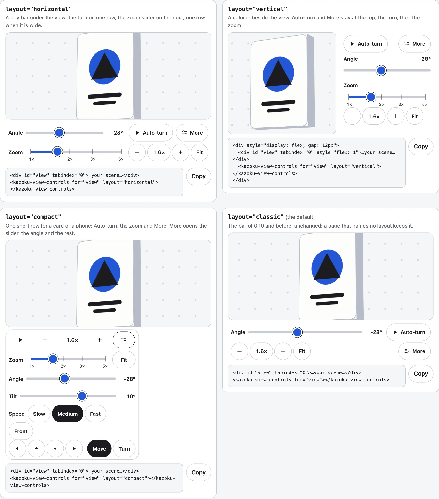
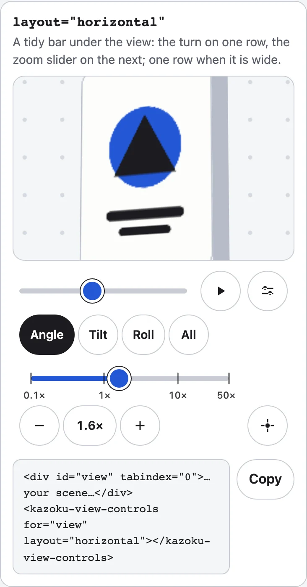

[English](../layouts-and-zoom.md)

`<kazoku-view-controls>`の`layout`属性は、操作の置き場所を決めます。何を表示するかは、どのレイアウトでも`controls`（`basic`か`advanced`）と、ユーザーの「詳細」で決まります。レイアウトを指定しないページは、これまでのバーのままです。



## 4つのレイアウト

| `layout` | 見た目 | basicで出るもの | 「詳細」で加わるもの |
|---|---|---|---|
| `classic`（既定） | これまでのバー。デスクトップでは折り返す1行、スマートフォンでは2行。ズームスライダーなし。 | 角度、自動回転、ズームの数値表示、全体表示、詳細 | 傾き、0.5×、1×、2×、正面。ズーム中は移動パッド |
| `horizontal` | ビューの下の整ったバー。1行目に回転の操作（角度、自動回転、詳細）、次の行に**ズームスライダー**。バーの幅が1040 px以上なら1行。560 px未満では、ラベルはスクリーンリーダーだけが読みます。440 px未満では、ズームスライダーだけで1行を使い、ボタンはその下に並ぶので、目盛りがボタンに重なりません。 | 角度、自動回転、ズームスライダー、数値表示、全体表示、詳細 | 傾きと正面、続いて速さ。移動パッドは最後 |
| `vertical` | ビューの横の縦長の列。幅は`--kazoku-column-width`（16rem）。自動回転と「詳細」が上にあるので、「詳細」を開いても動きません。 | 自動回転、詳細、角度、ズームスライダー、数値表示、全体表示 | 傾き、速さ、正面、移動パッド |
| `compact` | 場所を最小限しか取りません。カードやスマートフォン向けに、自動回転、縮小、数値表示、拡大、詳細を**1行**に収めます。「詳細」を押すまで2行目にはなりません。 | 自動回転、数値表示、詳細 | そのほかすべて。1回押すと、行の下に出ます |

```html
<div id="view" tabindex="0" style="height: 200px">Your scene</div>
<kazoku-view-controls for="view" layout="horizontal"></kazoku-view-controls>
<script type="module">import "@johnmorrisdotca/kazoku-ui/view-controls/define";</script>
```

縦長のバーは、ビューの横に置きます。幅の狭い画面では、ビューの下に置き、`width: auto`を指定してください。

```html
<div style="display: flex; gap: 12px">
  <div id="view" tabindex="0" style="flex: 1; min-height: 240px">Your scene</div>
  <kazoku-view-controls for="view" layout="vertical"></kazoku-view-controls>
</div>
<script type="module">import "@johnmorrisdotca/kazoku-ui/view-controls/define";</script>
```

コンパクトなバーは、`overlay`を付けると、位置指定したカードの下隅に重ねて浮かせられます。

```html
<div style="position: relative; height: 240px">
  <div id="view" tabindex="0" style="height: 100%">Your scene</div>
  <kazoku-view-controls for="view" layout="compact" overlay></kazoku-view-controls>
</div>
<script type="module">import "@johnmorrisdotca/kazoku-ui/view-controls/define";</script>
```

`layout`はいつでも変えられます。4つの語以外は`classic`になります。ホスト要素には、使用中のレイアウトが`data-layout`として付きます。`parseLayout`は語を読み、`LAYOUTS`は4つを並べます。

```js
import { LAYOUTS, parseLayout } from "@johnmorrisdotca/kazoku-ui/view-controls";

console.log(LAYOUTS.join(" "));
console.log(parseLayout("compact"), parseLayout("sideways"), parseLayout(null));
// classic horizontal vertical compact
// compact classic classic
```



## ズームスライダー

`horizontal`、`vertical`、`compact`のレイアウトには、ズームスライダーがあります。`zoom-min`から`zoom-max`までを対数の目盛りで表すので、縮小や拡大のボタンを1回押したときの動く距離が、どこでも同じです。目盛りは両端と、その間に収まる一般的なズーム（たとえば1x、2x、3x、5x）に付き、目盛りの近くでドラッグを放すと、その目盛りに吸い付きます。

目盛りの計算はふつうの算術なので、自分のスライダーのために呼べます。

```js
import { COMMON_ZOOMS, MARK_GAP, SLIDER_STEP, SNAP_PX, zoomAtPosition, zoomMarks, zoomPosition, zoomSnap, zoomStep, zoomText, zoomToMark } from "@johnmorrisdotca/kazoku-ui/view-controls";

const marks = zoomMarks(1, 5);
console.log(marks.map((mark) => `${mark.zoom}@${mark.at.toFixed(2)}${mark.end ? "!" : ""}`).join(" "));
console.log(COMMON_ZOOMS.join(" "), MARK_GAP, SLIDER_STEP, SNAP_PX);
console.log(zoomPosition(2, 1, 5).toFixed(3), zoomAtPosition(0.5, 1, 5).toFixed(3));
console.log(zoomText(2.44), zoomText(0.5));
console.log(zoomStep(1.9, marks, 1, 1, 5), zoomToMark(2, marks, 1, 1, 5), zoomSnap(1.97, marks, 1, 5, 0.05));
// 1@0.00! 2@0.43 3@0.68 5@1.00!
// 1 2 4 0.5 3 10 8 5 0.25 6 16 20 32 50 64 100 0.18 1.1 8
// 0.431 2.236
// 2.4× 0.5×
// 2 3 2
```

- `zoomMarks(min, max, gap?)`は、範囲に対する目盛りを返します。両端と、ほかのどの目盛りからもスライダー長の`MARK_GAP`以上離れている、一般的なズームだけです。余地がなければ、目盛りは付きません。
- `zoomPosition(zoom, min, max)`と`zoomAtPosition(position, min, max)`は、ズームとスライダー上の位置（0から1）を相互に変換します。
- `zoomStep`は矢印キーです。`SLIDER_STEP`だけ上げ下げし、越える目盛りがあればまずそこで止まるので、1.9xは2xになり、次の1回でそれを越えます。
- `zoomToMark`はPage UpとPage Downです。上（1）か下（-1）の次の目盛りへ、なければ端へ移ります。
- `zoomSnap`は、目盛りの`tolerance`以内でドラッグが終わったとき、その目盛りへそっと引き寄せます。強制的に動かすものではありません。`SNAP_PX`は通常の引き寄せ（ピクセル）です。
- `zoomText`は数値表示です。`1×`、`2.4×`、1未満では有効数字2桁で、小さなズームが`0×`と出ないようにします。

## 範囲の選び方

目盛りは範囲に従います。既定は0.1倍から50倍です（広い理由は[要素が自分で操作を持つ](element-controls.md)にあります）。両端の比が`WIDE`（100倍）以上の範囲では、目盛りの印はまず10の累乗になり、0.1×、1×、10×、50×と並びます。0.5から8までズームするページは、`zoom-min="0.5"`と`zoom-max="8"`を指定すると、両端とその間の一般的なズームが出ます。8通りの範囲を並べたレイアウトのデモもあります。数値表示は、バーにある唯一の、本当のズーム値なので、押すと全体表示に戻ります。

```js
import { zoomMarks } from "@johnmorrisdotca/kazoku-ui/view-controls";

for (const [min, max] of [[1, 5], [0.5, 8], [1, 2], [0.1, 100]]) console.log(min, max, zoomMarks(min, max).map((mark) => mark.zoom).join(" "));
// 1 5 1 2 3 5
// 0.5 8 0.5 1 2 4 8
// 1 2 1 2
// 0.1 100 0.1 1 10 100
```
