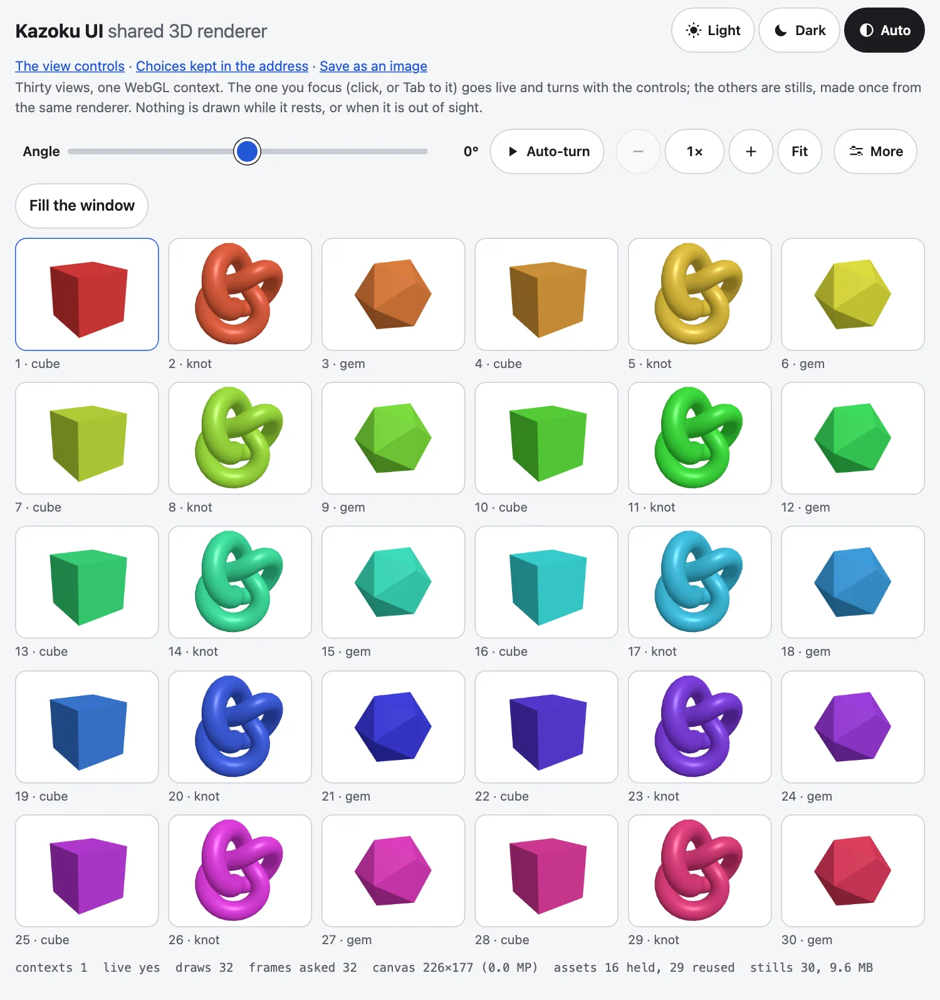

[English](../renderer.md)

`@johnmorrisdotca/kazoku-ui/renderer`は、ページに1つのWebGLコンテキストを与え、フォーカスのあるビューに渡し、ほかのビューは静止画にします。多くの3Dビューを持つページ（カードの壁、バインダー、機器の一覧など）向けです。three.jsはページ自身の依存のままで、この部品がインポートすることはありません。



## なぜコンテキストを1つにするのか

ブラウザーが保持するWebGLコンテキストは約16個で、古いものは何も言わずに壊されます。ライブのビューが40個あれば、24個が壊れ、1秒に36,000回の描画が行われます（ヘッドレスChromiumで、40枚のカードで測定）。この部品ができる前は、3つのパッケージがそれぞれ自力で解決し、3通りに間違えていました。描いた1回につき2回のフレームを要求する描画ループ、解放されないGPUバッファ、ピクセルの上限がないキャンバス（ピクセル比2の5K画面で2400万ピクセル）です。

## 使い方

three.jsは、省略可能な**ピア依存**です。静止画だけのページは3Dのコードを一切配信しません。threeは、最初のビューがライブになるときに読み込まれるからです。`import("three")`を行うのはページで、そのバンドラーが自分のコピーを解決するので、二重にバンドルされません。

```ts no-check
import { createSharedRenderer, type Item3D } from "@johnmorrisdotca/kazoku-ui/renderer";

const renderer = createSharedRenderer({ load: () => import("three") });   // nothing is loaded yet

// The package's adapter: what one kind of item looks like.
const cube = (colour: string): Item3D<typeof import("three")> => ({
  key: `cube:${colour}`,                       // items with the same key share one still
  build({ three, assets, width, height }) {
    const geometry = assets.acquire("geometry:cube", () => new three.BoxGeometry(1, 1, 1), (g) => g.dispose());
    const material = assets.acquire(`material:${colour}`, () => new three.MeshStandardMaterial({ color: colour }), (m) => m.dispose());
    const scene = new three.Scene();
    scene.add(new three.Mesh(geometry, material), new three.AmbientLight(0xffffff, 2));
    const camera = new three.PerspectiveCamera(35, width / height, 0.1, 50);
    camera.position.z = 5;
    return { scene, camera, resize: (w, h) => { camera.aspect = w / h; camera.updateProjectionMatrix(); } };
  },
});

const view = renderer.view(hostElement, cube("#2457d6"));   // the host shows a still; no GL yet
view.showStill();                                           // make the still when the host comes into sight
hostElement.addEventListener("focus", () => view.focus());  // the focus policy is the package's
```

`view.invalidate()`は、ビューを動かすものにつなぎます。たとえば`<kazoku-view-controls>`です。

```ts no-check
controls.view = view.host;                                                      // bind the hands to the live host
controls.addEventListener("kazoku-viewchange", (e) => { view.scene.pose(e.detail); view.invalidate(); });
```

自前の要素から`/renderer`をインポートするパッケージは、このパッケージを依存に、`three`をピア依存に挙げます（3Dなしでも動くなら、`peerDependenciesMeta`で省略可能にします）。デモだけで使うパッケージは、両方を開発依存にします。

## 何をしてくれるか

| | |
|---|---|
| 1つのレンダラー | `view.focus()`は、唯一のキャンバスをそのビューのホストに移してシーンを作り、持っていたビューは静止画に戻ります。ビューがライブになれば`true`、その間にほかのビューがフォーカスを取った場合や、WebGLが使えない場合は`false`で解決します。 |
| 共有アセット | シーンに必要なものはすべて`assets.acquire(key, make, dispose)`を通します。最初に求めた側のために1回だけ作られ、キーで共有され、数えられ、最後のビューが手放して`lingerMs`（1秒）後に破棄されます。`disposeDeep(model)`は、読み込んだモデルのジオメトリ、マテリアル、テクスチャを解放します。 |
| 静止画 | `view.showStill()`は、アイテムを同じレンダラーから1回だけ描き、PNGのBlobにして、ホスト内の``に表示します。同じ`key`のアイテムは画像を共有し、バイト予算（`stillBytes`、展開後32 MB）つきの、最近使われていないものから捨てる一覧に入ります。 |
| 必要なときだけの描画 | すべてのビューに、スケジューラーは1つです。静止しているページは、ブラウザーに何も求めません。アニメーションフレームも描画もありません。フレームの要求は常に1つで、1フレームには予算があります。1フレームの描画は最大2回で、10 msを超えたら新しい描画は始めません。フォーカスのビューが先です。 |
| 毎秒30フレームまで | ビューは、画面のリフレッシュレートによらず、1秒に`MAX_FPS`（30）回までしか描かれません。直前の描画から1フレーム分の間隔（1000/30 ms。ブラウザーのタイミングの誤差を見込んで2 ms短くしています）に満たないビューは、そのフレームでは描かれずに待ち、次のフレームが要求されます。60 Hzの画面は2フレームに1回で毎秒30回、120 Hzは4フレームに1回で毎秒30回、144 Hzは5フレームに1回で毎秒28.8回です。静止していたビューや、非表示のタブから戻ったビューは、次のフレームですぐに描かれます。`dt`は、そのビューが前回実際に描かれてからの経過時間のままなので、動きの速さは変わりません。 |
| 見えていないとき | ライブのビューのホストとタブの表示状態が見張られ、画面外や非表示のタブではフレームを要求しません。画面外のまま`releaseMs`（30秒）たつと、コンテキストそのものを手放し、ビューは静止画を保ち、ビューが見えるとコンテキストを作り直します。 |
| ピクセルの予算 | 最大600万ピクセル、1辺4096、ピクセル比2。ピクセル比2の5K画面は約1.5で描かれ、CSSで拡大されます。2400万ピクセルでは描きません。3つとも、オプションです。 |
| コンテキストの喪失 | `webglcontextlost`は止められ、描画が止まり、静止画が表示され、`onContext("lost")`が呼ばれます。復元されると、ビューは再び描き、`onContext("restored")`が呼ばれます。 |

## API

- `createSharedRenderer({ load, maxPixels, maxSide, maxRatio, stillSize, stillBytes, lingerMs, releaseMs, antialias, onContext, clock, document, assets, scheduler })`
- `renderer.view(host, item, { still })`はビューを返します：`focus()`、`blur()`、`invalidate()`、`showStill()`、`dispose()`、`live`、`scene`、`host`、`item`。
- `renderer.focused`、`renderer.stats`（`contexts`、`draws`、`snapshots`、`live`、`lost`、`canvas`、`frames`、`assets`、`stills`）、`renderer.assets`、`renderer.stills`、`renderer.scheduler`、`renderer.dispose()`。
- アイテムは`{ key, build({ three, assets, width, height }) }`で、`{ scene, camera, update?, resize?, dispose? }`を返します。`update(dt, now)`は動いているものがあれば真を返し、ビューは上限（毎秒30回まで）が許す次のフレームで再び描かれます。

ホストには（CSSの）大きさが必要です。`position: static`の場合は`position: relative`にされます。キャンバスはそのパディングボックスを埋めます。見えているライブのビューを同時に複数持つことは、サポートしません。それがこの部品の趣旨です。必要なパッケージは、唯一のキャンバスに描き、各ホスト自身の2Dキャンバスにコピーします。

## 部品を単独で

スケジューラー、アセットのキャッシュ、静止画のキャッシュ、ピクセルの計算にはDOMがなく、時計も引数で受け取るので、単独で使え、テストできます。

```js
import { MAX_PIXELS, MAX_RATIO, MAX_SIDE, STILL_BYTES, createAssetCache, createScheduler, createStillCache, pixelRatioFor } from "@johnmorrisdotca/kazoku-ui/renderer";

console.log(MAX_PIXELS, MAX_SIDE, MAX_RATIO, STILL_BYTES);
console.log(pixelRatioFor(800, 600, 2), pixelRatioFor(2560, 1440, 2).toFixed(3), pixelRatioFor(2560, 1440, 3, { maxRatio: 1 }));

const made = [];
const cache = createAssetCache({ lingerMs: 0, timers: { set: (callback) => { callback(); return 0; }, clear() {} } });
const a = cache.acquire("geometry", () => (made.push("make"), { id: 1 }), () => made.push("dispose"));
const b = cache.acquire("geometry", () => (made.push("make"), { id: 2 }));
console.log(a === b, JSON.stringify(cache.stats()));
cache.release("geometry");
cache.release("geometry");
console.log(made.join(" "));

const stills = createStillCache({ maxBytes: 100 });
stills.set("a", { url: "a", width: 1, height: 1, bytes: 60 });
stills.set("b", { url: "b", width: 1, height: 1, bytes: 60 });
console.log(stills.keys().join(" "), stills.bytes, stills.size);

let queued;
const clock = { request: (callback) => ((queued = callback), 1), cancel() {}, now: () => 0 };
const scheduler = createScheduler({ clock });
const drawn = [];
const job = { draw: (now, dt) => { drawn.push(dt); return false; } };
scheduler.invalidate(job);
scheduler.invalidate(job);
console.log(scheduler.pending, scheduler.stats.requests);
queued(16);
console.log(scheduler.pending, JSON.stringify(scheduler.stats), drawn.length);
// 6000000 4096 2 33554432
// 2 1.275 1
// true {"entries":1,"refs":2,"hits":1,"misses":1,"disposed":0}
// make dispose
// b 60 1
// true 1
// false {"requests":1,"frames":1,"draws":1,"deferred":0} 1
```

- `pixelRatioFor(width, height, deviceRatio, limits?)`は、キャンバスを描くピクセル比です。端末のピクセル比を`MAX_RATIO`までに抑え、さらに、キャンバスが`MAX_PIXELS`と`MAX_SIDE`に収まるまで下げた値になります。
- `MAX_FPS`（30）は、1つのジョブが1秒に描かれる最大回数です。ファミリー共通のルール（ライブ3Dは毎秒30フレームまで）なので、オプションではありません。
- `createScheduler({ clock, maxDraws, budgetMs })`は、`invalidate(job, priority?)`、`remove(job)`、`pause()`、`resume()`と、`stats`の数値を返します。`Job`は`{ draw(now, dt) }`で、真を返した`draw`は、毎秒30回までの上限が許す次のフレームで、また描かれます。`browserClock()`は本物の時計、`FrameClock`は代わりの形です。
- `createAssetCache({ lingerMs, timers })`は、`acquire(key, make, dispose?)`、`release(key)`、`scope()`（1つのビューが取るもの。`release()`1回で手放します）、`clear()`、`stats()`を返します。
- `createStillCache({ maxBytes, free, onEvict })`は、バイト予算のある画像の一覧です：`get`、`set`、`delete`、`clear`、`bytes`、`size`、`keys()`。
- `disposeDeep(root)`は、読み込んだモデルが持つものを解放します。ダックタイピングなので、threeのインポートは要りません。

## フリーズ検査

`@johnmorrisdotca/kazoku-ui/testing`は、3Dパッケージのエンドツーエンドテスト共通の検証を提供します。キットは特定のテストフレームワークに依存しません。PlaywrightのPageがそのまま使えます。

```js no-check
import { COUNT_SCRIPT, canvasSize, gpuObjects, readCounts, withinPixelBudget } from "@johnmorrisdotca/kazoku-ui/testing";

await page.addInitScript(COUNT_SCRIPT);           // before page.goto: counts contexts, GL objects, draws and animation frames
await page.goto(url);
const before = await readCounts(page);
// ... focus thirty views, fifty times ...
const after = await readCounts(page);
expect(after.contexts).toBe(1);                                  // one WebGL context
expect(gpuObjects(after)).toBe(gpuObjects(before));              // created minus deleted: flat over the run
expect(withinPixelBudget(await canvasSize(page))).toBe(true);    // at 5120x2880, ratio 2: within 6 MP and 4096 a side
// and at rest: wait, read again, and expect draws and rafRequests not to have moved.
```

上のブロックはテストの輪郭で、示すだけで実行しません。キットの純粋な部分は次のとおりです。

```js
import { GPU_KINDS, SOFTWARE_GL_ARGS, gpuObjects, withinPixelBudget } from "@johnmorrisdotca/kazoku-ui/testing";

console.log(GPU_KINDS.join(" "));
console.log(SOFTWARE_GL_ARGS.join(" "));
const zero = Object.fromEntries(GPU_KINDS.map((kind) => [kind, 0]));
console.log(gpuObjects({ contexts: 1, draws: 0, rafRequests: 0, rafCallbacks: 0, created: { ...zero, Buffer: 5, Texture: 2 }, deleted: { ...zero, Buffer: 4 } }));
console.log(withinPixelBudget({ pixels: 5_000_000, side: 4000, count: 1 }), withinPixelBudget({ pixels: 7_000_000, side: 4000, count: 1 }), withinPixelBudget({ pixels: 1_000_000, side: 5000, count: 1 }));
// Buffer Texture VertexArray Program Framebuffer Renderbuffer
// --use-gl=angle --use-angle=swiftshader --enable-unsafe-swiftshader --ignore-gpu-blocklist
// 3
// true false false
```

`COUNT_SCRIPT`はページにカウンターを入れ、`readCounts(page)`はそれを`GlCounts`として読み、`canvasSize(page)`はデバイスピクセルでの最大のキャンバス、`gpuObjects(counts)`はすべての種類での作成数から削除数を引いたものです。`SOFTWARE_GL_ARGS`は、ヘッドレスChromiumにWebGLをソフトウェア（SwiftShader上のANGLE）で描かせ、マシンのグラフィックスカードは決して使わせません。

## 決まり：フリーズ検査のない3Dのリリースはしない

ライブの3D（WebGL）を持つすべてのパッケージとアプリは、次の2つを備え、それなしにはリリースしません。1つ目は、リリースに組み込む**フリーズテスト**（`test:freeze`スクリプト）です。ヘッドレスChromiumでページを動かし、次のどれかで失敗します。1度に複数のアニメーションフレームを要求する。何も動いていない、またはビューが見えないのに描画する。変更を重ねるうちにWebGLコンテキストやGPUオブジェクトが増える。600万ピクセルまたは1辺4096を超えるキャンバスがある。2つ目は、**テストはソフトウェアで描き、マシンのグラフィックスカードでは描かない**ことです。PlaywrightのChromiumのプロジェクトはすべて、`launchOptions: { args: [...SOFTWARE_GL_ARGS] }`を使います。WebKitにはソフトウェアへの切り替えがないので、CI以外では、WebGLを描くページをスキップします。開発マシンでヘッドレスブラウザを同時に動かすのは1つだけにします。[ブラウザロック](browser-lock.md)が、2つ目の実行を待たせます。WebGLを使わないパッケージ（CSS 3D変形とSVGはWebGLではありません）は、どちらも要りません。

## この部品にないもの

フォーカスの方針（どのビューをライブにするか）と、各アイテムのシーンと静止画の構図は、パッケージ側に残ります。モデルはパッケージの`build`が読み込み、`assets.acquire(key, () => loader.loadAsync(url), (p) => p.then(disposeDeep))`でキャッシュします。
