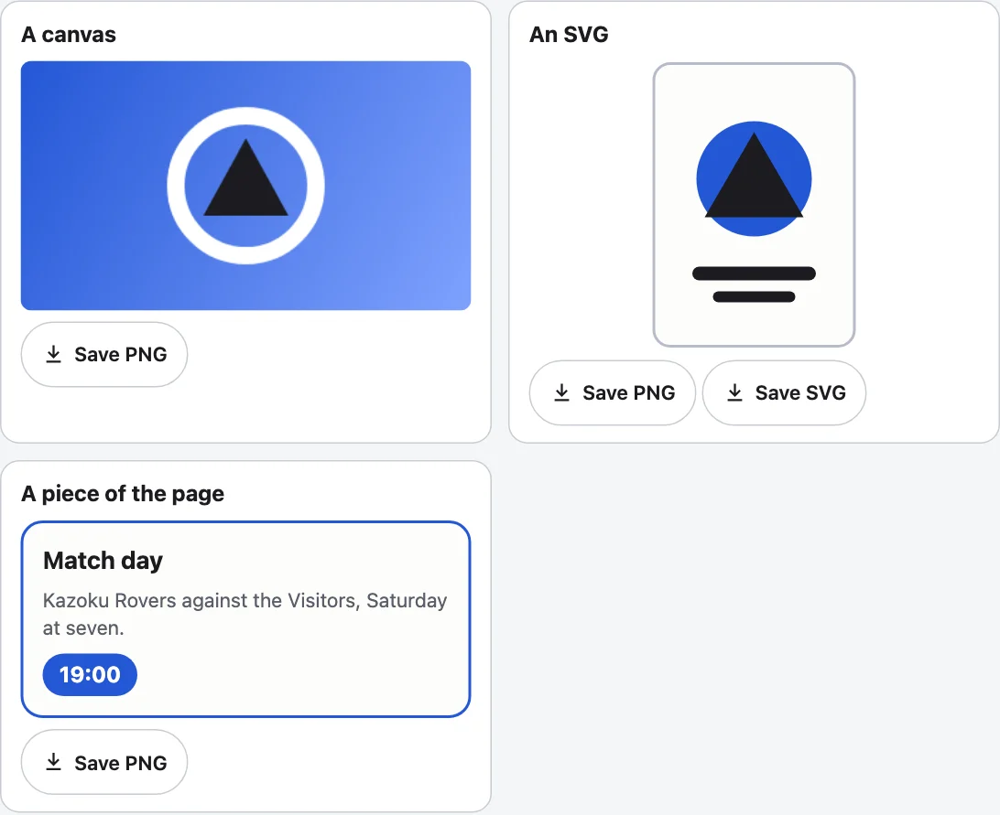

[English](../save-image.md)

`<kazoku-save-image>`は、ページ上のキャンバス、SVG、任意の要素の、PNG保存とSVG保存のボタンです。シーンを描くことはありません。対象が見せているものを保存し、その画像をダウンロードとしてブラウザーに渡し、イベントでページに知らせます。



## 使い方

```html
<canvas id="art" width="360" height="200"></canvas>
<kazoku-save-image for="art" name="my-picture"></kazoku-save-image>
<script type="module">
  import "@johnmorrisdotca/kazoku-ui/save-image/define";
</script>
```

| 対象 | ボタン | 方法 |
|---|---|---|
| `<canvas>` | PNG保存 | キャンバス自身のピクセルを、その大きさのまま。 |
| `<svg>` | PNG保存、SVG保存 | SVGを単独で成り立つ形（名前空間、大きさ、`viewBox`、描くのに使うスタイル）で書き出すか、PNGとして描きます。 |
| そのほかの要素 | PNG保存 | SVGの`foreignObject`を通して描き、計算済みのスタイルをすべて書き込みます。中の`<canvas>`は、絵として描き込まれます。 |

## 属性

| 属性 | |
|---|---|
| `for` | 対象のid。まずボタン自身のツリーの中から探します。`element.target = someElement`でも指定できます。 |
| `formats` | `png svg`：ボタンの種類と順序。対象が出せない形式は省かれます。 |
| `name` | 拡張子なしのファイル名。既定は`image`。ファイル名に不適切な文字は`-`になります。 |
| `scale` | SVGや要素のCSSピクセル1つあたりのPNGのピクセル数。既定は2。1辺が8192ピクセルを超えず、全体が3600万ピクセル以内になるように抑えられます。キャンバスは自身のピクセルサイズで保存されます。 |
| `background` | PNGの背後に塗るCSSの色。なければ透明。 |
| `manual` | 画像を作ってイベントを送りますが、ダウンロードはしません（ページがBlobを持ちます）。 |
| `no-inline-styles` | 保存するものに、計算済みのスタイルを含めません。 |
| `lang`、`theme` | `en`か`ja`。`light`か`dark`。 |

`element.save(format?)`は、ボタンと同じように保存し、イベントと同じ内容で解決します。`element.words = { png: "Download PNG" }`でラベルを置き換えられます。色は`--kazoku-ink`、`--kazoku-surface`、`--kazoku-line`、`--kazoku-accent`で、パーツは`group`と`button`です。

## イベント

`kazoku-save`（バブリングし、シャドウルートを越えます）は、画像ができたあとに送られます。`event.detail`には、`blob`、`format`（`png`か`svg`）、`width`、`height`（PNGはピクセル、SVGはCSSピクセル）、`filename`、`reason`（`user`か`api`）があります。`kazoku-saveerror`は、保存できなかったとき（対象がない、対象が出せない形式、ブラウザーが描画できない）に`{ format, error, reason }`を運びます。グループには、スクリーンリーダー向けの状態の行があります。

## 要素の画像に含められないもの

この画像は、ブラウザーが要素のSVG画像を描くことで作られ、画像にはネットワークも、背後のページもありません。そのため、Webフォントは含まれず（システムのフォントが使われます）、`::before`と`::after`は描かれず、``は`data:`のURLのものしか含まれず（別オリジンのものは省かれます）、要素の外にある`<use href="#id">`は見つかりません。そうしたものは、キャンバスに描き込んで、そのキャンバスを保存してください。

## 要素なしで

```js
import { FORMATS, MAX_PIXELS, MAX_SIDE, MIME, filenameFor, formatsFor, parseFormats, pixelSize } from "@johnmorrisdotca/kazoku-ui/save-image";

console.log(filenameFor("My Card/../x?", "png"), "|", filenameFor("jersey", "svg"));
console.log(JSON.stringify(pixelSize(2000, 1500, 2)), MAX_SIDE, MAX_PIXELS);
console.log(parseFormats("svg png").join(" "), parseFormats("gif").join(" "), FORMATS.join(" "));
console.log(formatsFor("canvas").join(" "), "|", formatsFor("svg").join(" "), "|", JSON.stringify(MIME));
// My Card-..-x.png | jersey.svg
// {"width":4000,"height":3000,"scale":2} 8192 36000000
// svg png png svg png svg
// png | png svg | {"png":"image/png","svg":"image/svg+xml"}
```

ページでは、数行で描画してダウンロードできます。

```js no-run
import { downloadBlob, filenameFor, renderImage, saveImage } from "@johnmorrisdotca/kazoku-ui/save-image";

const { blob, width, height } = await renderImage(document.getElementById("art"), { format: "png", scale: 2, background: "#fff" });
downloadBlob(blob, filenameFor("my picture", "png"));
await saveImage(document.getElementById("jersey"), { format: "svg", name: "jersey" }); // both in one
```

そのほかの関数：`kindOf(target)`は対象が何か（キャンバス、SVG、そのほかの要素）、`sizeOf(target)`はCSSピクセルでの大きさ、`serializeSvg(svg)`は単独で成り立つSVGのテキスト、`serializeElement(element)`は任意の要素を描くSVG、`svgToPng(text, width, height, scale, background?)`はSVGのテキストをPNGにします。`ERROR_EVENT`と`EVENT`が2つのイベント、`TAG`がタグの名前で、ラベルは`WORDS`と`wordsFor`です。インポート時にDOMには触れないので、このエントリーはサーバーでもインポートできます。

## 厳格なポリシー

ボタンのスタイルは、構築可能なスタイルシートとして適用されます。キャンバスはリクエストなしで保存されます。SVGや要素は、`data:`のURLの画像を通して描かれるので、`img-src`を設定するページは、その2つのために`data:`を許可する必要があります。[フレームワークとCSP](frameworks-and-csp.md)を参照してください。
