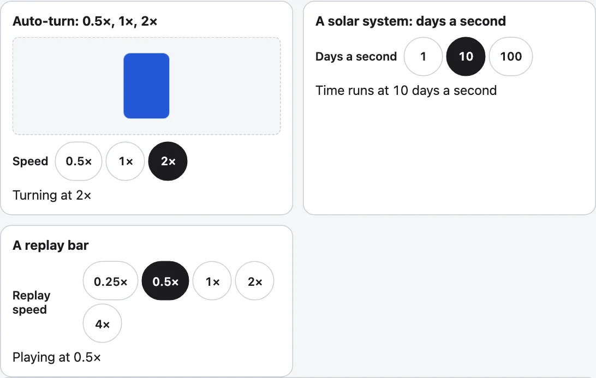

[English](../speed-buttons.md)

`<kazoku-speed-buttons>`は、速さごとに1つずつ並ぶボタンです。選んだものが押された状態になります。メニューはありません。ファミリーで共通の、速さの操作です。表示の操作では自動回転の速さに使い、太陽系の1秒あたりの日数やリプレイバーの速さも、ステップを変えただけの同じ要素です。そのため、速さの見え方がどこでも同じになります。要素自身は何も動かしません。伝えられた数字を、ページが使います。



## 使い方

```html
<kazoku-speed-buttons id="speed" steps="0.5 1 2" value="1" address></kazoku-speed-buttons>
<script type="module">
  import "@johnmorrisdotca/kazoku-ui/speed-buttons/define";
  document.getElementById("speed").addEventListener("kazoku-speedchange", ({ detail }) => {
    console.log(detail.value, detail.reason);
  });
</script>
```

| 用途 | ステップ | 見え方 |
|---|---|---|
| 自動回転 | `0.5 1 2`（既定） | 0.5×、1×、2× |
| 太陽系の時間 | `1 10 100`、`unit=""`、`label="1秒あたりの日数"` | 1、10、100 |
| リプレイバー | `0.25 0.5 1 2 4` | 0.25×、0.5×、1×、2×、4× |
| 止めたり戻したりできる時計 | `0 1 3600 86400 -3600` | 0×、1×、3600×、86400×、−3600× |

## 属性

| 属性 | |
|---|---|
| `steps` | 速さを、数字の並びで書きます（`0.5 1 2`。カンマでも書けます）。数字は何でもよく、0は停止、負の数は戻る向きにできます。既定は`0.5 1 2`です。 |
| `value` | 押されている速さです。開始値であり、ユーザーの選択に合わせて変わるので、属性はいつも今の値を表します。ステップにない値は、いちばん近いステップになります。 |
| `unit` | 各数字の後ろの文字です。既定は`×`で、空にすると数字だけになります。 |
| `label` | ボタンの前に表示され、スクリーンリーダーが読む、グループの名前です。既定は日本語で「速さ」（英語では"Speed"）。`no-label`で、見た目から隠せます。 |
| `address`、`address-key` | 選んだ速さを、ページのアドレスの`speed`（またはキー名）に残します。開始値は残らず、ほかのパラメーターはそのままです。 |
| `lang`、`theme` | `en`か`ja`。`light`か`dark`。 |

`element.format = (value, language) => ({ text, label })`を使うと、各ステップに数字と単位の代わりに自分の言葉を付けられます。`text`はボタンに表示され、`label`があれば画面読み上げで読まれます。表示操作はこれを使って、1周にかかる時間をボタンに出し（「30秒」）、読み上げでは「30秒で1周します」と読ませて、時間の速さと見分けやすくしています。`null`にすると数字に戻ります。

`element.value`で速さを読み書きし、`element.steps`でステップを読み書きし、`element.step(1)`で次の速さへ進みます（端まで来たら最初に戻ります。`-1`なら1つ前）。これは、押すたびに切り替わる1つのボタンの動きです。色は`--kazoku-ink`、`--kazoku-surface`、`--kazoku-line`、`--kazoku-accent`、パーツは`label`、`group`、`button`です。

## イベント

`kazoku-speedchange`（バブリングし、シャドウルートを越えます）の`detail.value`は選ばれたステップ、`detail.steps`はステップの一覧、`detail.reason`は理由です。理由は、立ち上がったとき1回だけの`init`、ボタンまたは`step()`の`user`、プロパティや属性の`set`です。動きの軽減を求めるユーザーでも、ボタンはいつもどおり切り替わります。ページが自分で動かすものを動かすかどうかは、ページが決めます。

## 表示の操作の中で

`<kazoku-view-controls>`は、「詳細」を開くと、自動回転の速さとして同じボタンを表示します。属性`pace`は`speed`に対する倍率（既定は1）、`paces`はボタンの数字を決め、ユーザーの選択は`pace`に書き戻され、アドレスには`?pace=2`として残ります。[表示の操作](view-controls.md)を見てください。基本のレベルで回っている間は、自動回転の横の小さなボタンが速さを表し、押すと次の速さになります。

## 要素なしで

```js
import { DEFAULT_STEPS, nearestStep, parseSpeed, parseSteps, speedText, startStep, stepFrom } from "@johnmorrisdotca/kazoku-ui/speed-buttons";

console.log(parseSteps("1, 10 100").join(" "), "|", DEFAULT_STEPS.join(" "));
console.log(speedText(0.5), speedText(-3600), speedText(10, " d/s"));
console.log(nearestStep(2.5, [1, 2, 4]), startStep([10, 100]), stepFrom(2, [0.5, 1, 2]));
console.log(parseSpeed("fast", [0.5, 1, 2]), parseSpeed("nope", [0.5, 1, 2]));
// 1 10 100 | 0.5 1 2
// 0.5× −3600× 10 d/s
// 2 10 0.5
// 2 undefined
```

`parseSteps(text, fallback?)`は並びを読み、`speedText(value, unit?)`はボタンに表示される形で速さを書き、`nearestStep(value, steps)`は値にいちばん近いステップを探し（0より大きい値は比で比べます）、`startStep(steps)`は1があれば1、なければ最初のステップを返し、`stepFrom(value, steps, direction?)`は端で戻りながら進み、`parseSpeed(text, steps)`はアドレスや属性を読みます（最初の表示の操作の`slow`、`medium`、`fast`は、今も0.5、1、2の意味です）。`SPEED_ADDRESS_KEY`、`DEFAULT_UNIT`、`EVENT`、`TAG`は名前の定数、ラベルは`WORDS`と`wordsFor`です。インポート時にDOMには触れないので、このエントリーはサーバーでも読み込めます。
