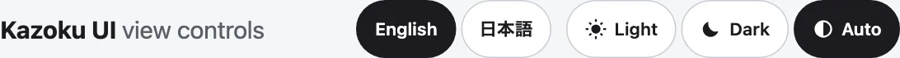

`<kazoku-language-picker>` is a button for each language the page gives, each in its own name (`English`, `日本語`, `Français`). It writes the choice as `lang` on a target (the page's `<html>` unless you name another), keeps it in the address and, if asked, in `localStorage`, and tells the page with an event. It translates nothing: your page reads the event and says its words.



## Use it

```html
<kazoku-language-picker languages="en ja" address storage></kazoku-language-picker>
<script type="module">
  import "@johnmorrisdotca/kazoku-ui/language-picker/define";

  document.addEventListener("kazoku-languagechange", ({ detail }) => console.log(detail.lang));
</script>
```

## Attributes

| Attribute | |
|---|---|
| `languages` | The codes, separated by spaces or commas: `en ja fr`. Valid ones, once each, in the order given. `en ja` by default. A code is lower case with dashes (`pt-br`); `ja_JP` and `EN` are read as `ja-jp` and `en`. |
| `value` | The language to start in. Setting it later applies it. |
| `target` | A CSS selector for the element that gets `lang`. The page's `<html>` by default. Found in the picker's own tree first. Or set `element.target = someElement`. |
| `address` | Keep the choice in the address (`?lang=ja`). `address-key` renames the parameter. |
| `storage` | Also remember it in `localStorage`. A bare `storage` uses the key `kazoku-lang`; `storage="my-key"` names it. |
| `theme` | `light` or `dark`: its own look, otherwise the page's. |

**Which language it starts in**, strongest first: the address, the store, `value`, the reader's languages (`navigator.languages`: a browser asking for `ja-JP` gets `ja`), what the target's `lang` says now, then the first code of `languages`. A tag matches the code it names or its main language (`ja-JP` is `ja`). A code the page did not list is never chosen.

`element.value` reads and sets it; `element.languages` is the list; `element.names = { fr: "Français (Canada)" }` replaces a name; `element.words = { group: "Choose a language" }` replaces the label of the group. Each button carries its own `lang`, so a screen reader says `日本語` in Japanese.

## The event

`kazoku-languagechange` is dispatched on the element and bubbles across shadow roots. `event.detail`:

| Field | Meaning |
|---|---|
| `lang` | The language now chosen: one of the codes, lower case. |
| `previous` | The one before; `undefined` at `init`. |
| `reason` | `init` (a moment after it connects), `user` (a button), `set` (the `value` property or attribute, or the list no longer holding the language), or `external` (something else wrote the target's `lang`). |
| `target` | The element the choice is written on. |

Something else writing `lang` on the target moves the picker with it, when the new value is one of its codes.

## Without the element

```js
import { DEFAULT_LANGUAGES, LANGUAGE_ADDRESS_KEY, LANGUAGE_ATTRIBUTE, LANGUAGE_STORAGE_KEY, OWN_NAMES, languageName, matchLanguage, normaliseCode, parseLanguages, startingLanguage } from "@johnmorrisdotca/kazoku-ui/language-picker";

console.log(DEFAULT_LANGUAGES.join(" "), LANGUAGE_ADDRESS_KEY, LANGUAGE_ATTRIBUTE, LANGUAGE_STORAGE_KEY);
console.log(parseLanguages("en ja pt_BR").join(" "), normaliseCode("ja_JP"), normaliseCode("not a code"));
console.log(languageName("ja"), languageName("fr"), languageName("en", { en: "English (CA)" }));
console.log(matchLanguage("ja-JP", ["en", "ja"]), matchLanguage("fr", ["en", "ja"]));
console.log(startingLanguage({ list: ["en", "ja"], search: "?lang=ja" }));
console.log(startingLanguage({ list: ["en", "ja"], preferred: ["ja-JP"] }), Object.keys(OWN_NAMES).includes("ja"));
// en ja lang lang kazoku-lang
// en ja pt-br ja-jp undefined
// 日本語 Français English (CA)
// ja undefined
// ja
// ja true
```

- `startingLanguage({ list, search, storage, value, preferred, current })` applies the order above and gives the code to start in.
- `applyLanguage(target, lang)` writes `lang` on a target.
- `languageName(code, names?)` is a language's own name: yours, then the family's table (`OWN_NAMES`), then `Intl.DisplayNames` in that language, else the code.
- `parseLanguages`, `matchLanguage` and `normaliseCode` read the codes. All of it imports on a server. The tag and the event names are `TAG` and `EVENT`; the labels are `WORDS` and `wordsFor`.

## Answering the picker

The picker only says which language was chosen. Your page does the rest, from a table of its own words, and the same table can serve the other parts: pass `lang` to the view controls and save-image buttons, or let them take the nearest `lang` above them, which the picker has just written.
