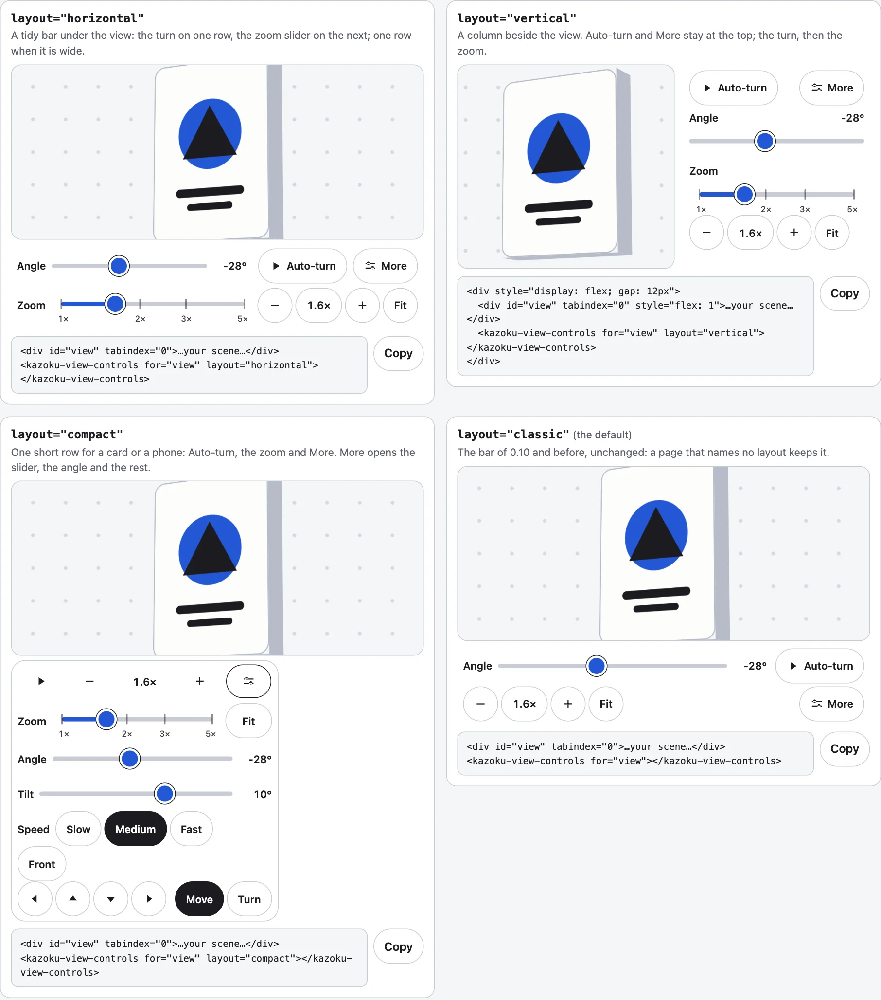
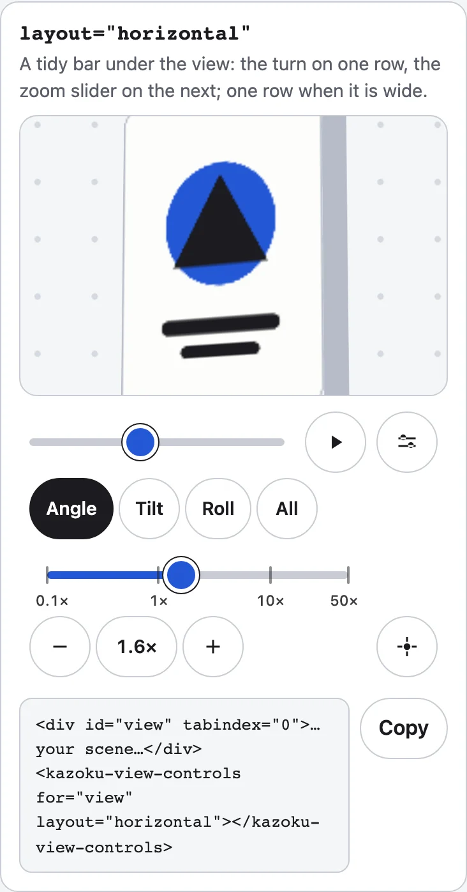

The `layout` attribute of `<kazoku-view-controls>` says where the controls sit. `controls` (`basic` or `advanced`, and the reader's More) still says what is shown, the same in every layout. A page that names no layout keeps the bar it had before.



## The four layouts

| `layout` | What it looks like | Basic shows | More adds |
|---|---|---|---|
| `classic` (the default) | The original bar: one wrapping row at a desk, two rows on a phone. No zoom slider. | Angle, Auto-turn, zoom readout, Fit, More | Tilt, Slow, Medium, Fast, Front; the pan pad once zoomed in |
| `horizontal` | A tidy bar under the view: the turn on one row (Angle, Auto-turn, More), the **zoom slider** on the next. One row when the bar is 900 px or wider. Under 560 px the labels are read by a screen reader only. | Angle, Auto-turn, the zoom slider, readout, Fit, More | Tilt and Front, then the speeds; the pan pad last |
| `vertical` | A column beside the view, `--kazoku-column-width` wide (16rem). Auto-turn and More at the top, so More does not move when it opens. | Auto-turn, More, Angle, the zoom slider, readout, Fit | Tilt, the speeds, Front, the pan pad |
| `compact` | The least room, for a card or a phone: **one row** of Auto-turn, minus, the readout, plus and More. It never takes a second row until More is pressed. | Auto-turn, readout, More | Everything else, one press away, under the row |

```html
<div id="view" tabindex="0" style="height: 200px">Your scene</div>
<kazoku-view-controls for="view" layout="horizontal"></kazoku-view-controls>
<script type="module">import "@johnmorrisdotca/kazoku-ui/view-controls/define";</script>
```

A vertical bar goes beside the view; on a narrow screen put it under the view and give it `width: auto`:

```html
<div style="display: flex; gap: 12px">
  <div id="view" tabindex="0" style="flex: 1; min-height: 240px">Your scene</div>
  <kazoku-view-controls for="view" layout="vertical"></kazoku-view-controls>
</div>
<script type="module">import "@johnmorrisdotca/kazoku-ui/view-controls/define";</script>
```

A compact bar can float over the bottom corner of a positioned card with `overlay`:

```html
<div style="position: relative; height: 240px">
  <div id="view" tabindex="0" style="height: 100%">Your scene</div>
  <kazoku-view-controls for="view" layout="compact" overlay></kazoku-view-controls>
</div>
<script type="module">import "@johnmorrisdotca/kazoku-ui/view-controls/define";</script>
```

`layout` can change at any time; anything else than the four words is `classic`. The host carries `data-layout` with the layout in use. `parseLayout` reads a word, and `LAYOUTS` lists the four:

```js
import { LAYOUTS, parseLayout } from "@johnmorrisdotca/kazoku-ui/view-controls";

console.log(LAYOUTS.join(" "));
console.log(parseLayout("compact"), parseLayout("sideways"), parseLayout(null));
// classic horizontal vertical compact
// compact classic classic
```



## The zoom slider

The horizontal, vertical and compact layouts have a zoom slider. It runs from `zoom-min` to `zoom-max` on a logarithmic scale, so a press of the minus or plus button moves it the same distance anywhere along it. It has marks, labelled at the two ends and at the common zooms between them that fit (1x, 2x, 3x and 5x, for example), and a drag that lets go near a mark settles on it.

The scale is plain arithmetic you can call yourself, for a slider of your own:

```js
import { COMMON_ZOOMS, MARK_GAP, SLIDER_STEP, SNAP_PX, zoomAtPosition, zoomMarks, zoomPosition, zoomSnap, zoomStep, zoomText, zoomToMark } from "@johnmorrisdotca/kazoku-ui/view-controls";

const marks = zoomMarks(1, 5);
console.log(marks.map((mark) => `${mark.zoom}@${mark.at.toFixed(2)}${mark.end ? "!" : ""}`).join(" "));
console.log(COMMON_ZOOMS.join(" "), MARK_GAP, SLIDER_STEP, SNAP_PX);
console.log(zoomPosition(2, 1, 5).toFixed(3), zoomAtPosition(0.5, 1, 5).toFixed(3));
console.log(zoomText(2.44), zoomText(0.5));
console.log(zoomStep(1.9, marks, 1, 1, 5), zoomToMark(2, marks, 1, 1, 5), zoomSnap(1.97, marks, 1, 5, 0.05));
// 1@0.00! 2@0.43 3@0.68 5@1.00!
// 1 2 4 0.5 3 10 8 5 0.25 6 16 20 32 50 64 100 0.18 1.1 8
// 0.431 2.236
// 2.4× 0.5×
// 2 3 2
```

- `zoomMarks(min, max, gap?)` gives the marks for a range: both ends, then the common zooms inside that keep `MARK_GAP` of the slider's length from every other mark. None where there is no room.
- `zoomPosition(zoom, min, max)` and `zoomAtPosition(position, min, max)` convert between a zoom and a place on the slider, 0 to 1.
- `zoomStep` is an arrow key: one `SLIDER_STEP` up or down, stopping first on a mark it would pass, so 1.9x goes to 2x and the next press goes on past it.
- `zoomToMark` is Page Up and Page Down: the next mark above (1) or below (-1), else the end.
- `zoomSnap` pulls a drag that ends within `tolerance` of a mark onto it, a gentle pull, never a forced step; `SNAP_PX` is the usual pull in pixels.
- `zoomText` is the readout: `1×`, `2.4×`, and below 1 two figures so a small zoom never reads `0×`.

## Choosing a range

The marks follow the range. A page that zooms from 0.5 to 8 sets `zoom-min="0.5"` and `zoom-max="8"` and gets the ends and the common zooms between them; see the layouts demo for eight ranges side by side. The readout is the one zoom number on the bar, the true one, so a press on it goes back to Fit.

```js
import { zoomMarks } from "@johnmorrisdotca/kazoku-ui/view-controls";

for (const [min, max] of [[1, 5], [0.5, 8], [1, 2]]) console.log(min, max, zoomMarks(min, max).map((mark) => mark.zoom).join(" "));
// 1 5 1 2 3 5
// 0.5 8 0.5 1 2 4 8
// 1 2 1 2
```
