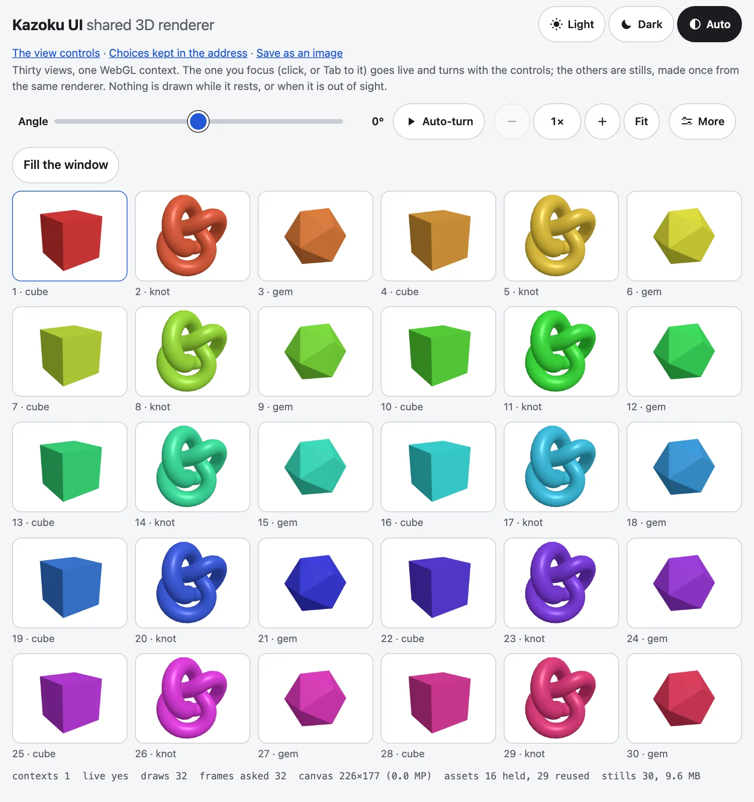

`@johnmorrisdotca/kazoku-ui/renderer` gives a page one WebGL context, handed to the view that has the focus, with every other view showing a still. It is for a page that holds many 3D views: a wall of cards, a binder, a list of devices. three.js stays the page's own dependency; this part never imports it.



## Why one context

A browser keeps about 16 WebGL contexts and silently kills the older ones, so 40 live views is 24 broken ones and 36,000 draws a second (measured in headless Chromium on 40 cards). Before this part, three packages each solved it alone and got it wrong in three ways: a draw loop that asked for two frames for every one it drew, GPU buffers never given back, and a canvas with no pixel cap (24 MP on a 5K screen at ratio 2).

## Use it

three.js is an optional **peer dependency**: a page of stills ships no 3D code, because three loads only when the first view goes live. The page does the `import("three")`, so its bundler resolves its own copy and nothing is bundled twice.

```ts no-check
import { createSharedRenderer, type Item3D } from "@johnmorrisdotca/kazoku-ui/renderer";

const renderer = createSharedRenderer({ load: () => import("three") });   // nothing is loaded yet

// The package's adapter: what one kind of item looks like.
const cube = (colour: string): Item3D<typeof import("three")> => ({
  key: `cube:${colour}`,                       // items with the same key share one still
  build({ three, assets, width, height }) {
    const geometry = assets.acquire("geometry:cube", () => new three.BoxGeometry(1, 1, 1), (g) => g.dispose());
    const material = assets.acquire(`material:${colour}`, () => new three.MeshStandardMaterial({ color: colour }), (m) => m.dispose());
    const scene = new three.Scene();
    scene.add(new three.Mesh(geometry, material), new three.AmbientLight(0xffffff, 2));
    const camera = new three.PerspectiveCamera(35, width / height, 0.1, 50);
    camera.position.z = 5;
    return { scene, camera, resize: (w, h) => { camera.aspect = w / h; camera.updateProjectionMatrix(); } };
  },
});

const view = renderer.view(hostElement, cube("#2457d6"));   // the host shows a still; no GL yet
view.showStill();                                           // make the still when the host comes into sight
hostElement.addEventListener("focus", () => view.focus());  // the focus policy is the package's
```

Connect `view.invalidate()` to whatever moves the view, for example `<kazoku-view-controls>`:

```ts no-check
controls.view = view.host;                                                      // bind the hands to the live host
controls.addEventListener("kazoku-viewchange", (e) => { view.scene.pose(e.detail); view.invalidate(); });
```

A package that imports `/renderer` from its own element lists this package as a dependency and `three` as a peer dependency (marked optional in `peerDependenciesMeta` if it works without 3D); a package that uses it only in its demo makes both devDependencies.

## What it does for you

| | |
|---|---|
| One renderer | `view.focus()` moves the single canvas into that view's host and builds its scene; the view that had it goes back to its still. It resolves `true` when the view is live and `false` if another view took the focus meanwhile or WebGL is not available. |
| Shared assets | Everything a scene needs goes through `assets.acquire(key, make, dispose)`: made once for the first asker, shared by key, counted, disposed `lingerMs` (1 s) after the last view lets go. `disposeDeep(model)` frees a loaded model's geometries, materials and textures. |
| Stills | `view.showStill()` renders the item once from the same renderer into a PNG blob and shows it in an `` in the host. Items with the same `key` share a picture, in a least-recently-used list with a byte budget (`stillBytes`, 32 MB decoded). |
| Drawing on demand | One scheduler for every view. A page at rest asks the browser for nothing: no animation frame, no draw. Exactly one frame is requested at a time, and a frame has a budget: at most 2 draws and 10 ms before a new draw starts, the focused view first. |
| At most 30 frames a second | A view is drawn at most `MAX_FPS` (30) times a second, whatever the screen's refresh rate: a view that drew less than a frame gap ago (1000/30 ms, less 2 ms for the browser's timing) stays dirty and is skipped this frame, which still asks for the next one. A 60 Hz screen draws every second frame (30 a second), 120 Hz every fourth (30), 144 Hz every fifth (28.8). A view at rest, or one that comes back from a hidden tab, is drawn on the very next frame. `dt` is still the time since the view's last real draw, so the motion keeps its speed. |
| Out of sight | The live view's host and the tab's visibility are watched: out of sight or in a hidden tab no frame is requested. After `releaseMs` (30 s) out of sight the context itself is let go, the views keep their stills, and the context is made again when the view is seen. |
| Pixel budget | At most 6 million pixels, 4096 on a side and ratio 2. A 5K screen at ratio 2 is drawn at about 1.5 and scaled up by CSS, not at 24 MP. All three are options. |
| Context loss | `webglcontextlost` is prevented, drawing stops, the still is shown, and `onContext("lost")` is called; on restore the view draws again and `onContext("restored")` is called. |

## API

- `createSharedRenderer({ load, maxPixels, maxSide, maxRatio, stillSize, stillBytes, lingerMs, releaseMs, antialias, onContext, clock, document, assets, scheduler })`.
- `renderer.view(host, item, { still })` returns a view: `focus()`, `blur()`, `invalidate()`, `showStill()`, `dispose()`, `live`, `scene`, `host`, `item`.
- `renderer.focused`, `renderer.stats` (`contexts`, `draws`, `snapshots`, `live`, `lost`, `canvas`, `frames`, `assets`, `stills`), `renderer.assets`, `renderer.stills`, `renderer.scheduler`, `renderer.dispose()`.
- An item is `{ key, build({ three, assets, width, height }) }` returning `{ scene, camera, update?, resize?, dispose? }`; `update(dt, now)` returns true while something moves, and the view is then drawn again at the next frame the cap lets it have (at 30 a second).

The host needs a size (CSS) and is made `position: relative` if it is static; the canvas fills its padding box. Several visible live views at once are not supported, which is the point: a package that needs them renders to the one canvas and copies into each host's own 2D canvas.

## The parts alone

The scheduler, the asset cache, the still cache and the pixel arithmetic have no DOM and take their clocks as arguments, so they can be used and tested alone:

```js
import { MAX_PIXELS, MAX_RATIO, MAX_SIDE, STILL_BYTES, createAssetCache, createScheduler, createStillCache, pixelRatioFor } from "@johnmorrisdotca/kazoku-ui/renderer";

console.log(MAX_PIXELS, MAX_SIDE, MAX_RATIO, STILL_BYTES);
console.log(pixelRatioFor(800, 600, 2), pixelRatioFor(2560, 1440, 2).toFixed(3), pixelRatioFor(2560, 1440, 3, { maxRatio: 1 }));

const made = [];
const cache = createAssetCache({ lingerMs: 0, timers: { set: (callback) => { callback(); return 0; }, clear() {} } });
const a = cache.acquire("geometry", () => (made.push("make"), { id: 1 }), () => made.push("dispose"));
const b = cache.acquire("geometry", () => (made.push("make"), { id: 2 }));
console.log(a === b, JSON.stringify(cache.stats()));
cache.release("geometry");
cache.release("geometry");
console.log(made.join(" "));

const stills = createStillCache({ maxBytes: 100 });
stills.set("a", { url: "a", width: 1, height: 1, bytes: 60 });
stills.set("b", { url: "b", width: 1, height: 1, bytes: 60 });
console.log(stills.keys().join(" "), stills.bytes, stills.size);

let queued;
const clock = { request: (callback) => ((queued = callback), 1), cancel() {}, now: () => 0 };
const scheduler = createScheduler({ clock });
const drawn = [];
const job = { draw: (now, dt) => { drawn.push(dt); return false; } };
scheduler.invalidate(job);
scheduler.invalidate(job);
console.log(scheduler.pending, scheduler.stats.requests);
queued(16);
console.log(scheduler.pending, JSON.stringify(scheduler.stats), drawn.length);
// 6000000 4096 2 33554432
// 2 1.275 1
// true {"entries":1,"refs":2,"hits":1,"misses":1,"disposed":0}
// make dispose
// b 60 1
// true 1
// false {"requests":1,"frames":1,"draws":1,"deferred":0} 1
```

- `pixelRatioFor(width, height, deviceRatio, limits?)` is the ratio to draw a canvas at: the device's, held to `MAX_RATIO`, then lowered until the canvas fits `MAX_PIXELS` and `MAX_SIDE`.
- `MAX_FPS` (30) is the most draws of one job in a second; it is not an option, because the family's rule for live 3D is 30.
- `createScheduler({ clock, maxDraws, budgetMs })` gives `invalidate(job, priority?)`, `remove(job)`, `pause()`, `resume()` and the counts in `stats`. A `Job` is `{ draw(now, dt) }`, and a `draw` that returns true is drawn again at the next frame the 30 a second cap allows. `browserClock()` is the real clock and `FrameClock` the shape of a stand-in.
- `createAssetCache({ lingerMs, timers })` gives `acquire(key, make, dispose?)`, `release(key)`, `scope()` (what one view takes, let go with one `release()`), `clear()` and `stats()`.
- `createStillCache({ maxBytes, free, onEvict })` is the byte-budgeted list of pictures: `get`, `set`, `delete`, `clear`, `bytes`, `size`, `keys()`.
- `disposeDeep(root)` frees what a loaded model holds, duck-typed so it needs no three import.

## The freeze checks

`@johnmorrisdotca/kazoku-ui/testing` has the same assertions for every 3D package's end-to-end test. The kit names no test framework; Playwright's `page` fits.

```js no-check
import { COUNT_SCRIPT, canvasSize, gpuObjects, readCounts, withinPixelBudget } from "@johnmorrisdotca/kazoku-ui/testing";

await page.addInitScript(COUNT_SCRIPT);           // before page.goto: counts contexts, GL objects, draws and animation frames
await page.goto(url);
const before = await readCounts(page);
// ... focus thirty views, fifty times ...
const after = await readCounts(page);
expect(after.contexts).toBe(1);                                  // one WebGL context
expect(gpuObjects(after)).toBe(gpuObjects(before));              // created minus deleted: flat over the run
expect(withinPixelBudget(await canvasSize(page))).toBe(true);    // at 5120x2880, ratio 2: within 6 MP and 4096 a side
// and at rest: wait, read again, and expect draws and rafRequests not to have moved.
```

The block above is an outline of a test, so it is shown and not run. The pure parts of the kit are:

```js
import { GPU_KINDS, SOFTWARE_GL_ARGS, gpuObjects, withinPixelBudget } from "@johnmorrisdotca/kazoku-ui/testing";

console.log(GPU_KINDS.join(" "));
console.log(SOFTWARE_GL_ARGS.join(" "));
const zero = Object.fromEntries(GPU_KINDS.map((kind) => [kind, 0]));
console.log(gpuObjects({ contexts: 1, draws: 0, rafRequests: 0, rafCallbacks: 0, created: { ...zero, Buffer: 5, Texture: 2 }, deleted: { ...zero, Buffer: 4 } }));
console.log(withinPixelBudget({ pixels: 5_000_000, side: 4000, count: 1 }), withinPixelBudget({ pixels: 7_000_000, side: 4000, count: 1 }), withinPixelBudget({ pixels: 1_000_000, side: 5000, count: 1 }));
// Buffer Texture VertexArray Program Framebuffer Renderbuffer
// --use-gl=angle --use-angle=swiftshader --enable-unsafe-swiftshader --ignore-gpu-blocklist --disable-gpu-rasterization
// 3
// true false false
```

`COUNT_SCRIPT` installs the counters in a page; `readCounts(page)` reads them as `GlCounts`; `canvasSize(page)` is the biggest canvas in device pixels; `gpuObjects(counts)` is created minus deleted, over every kind. `SOFTWARE_GL_ARGS` makes headless Chromium draw WebGL in software (ANGLE on SwiftShader), never on the machine's graphics card, and the page's own pictures on the CPU. `drainGpu` and `untilStill` are below.

### Draw in software, and drain the GPU's backlog

`SOFTWARE_GL_ARGS` also carries `--disable-gpu-rasterization`. Without it, Chromium rasterizes a page's own pictures (SVG, text, a map) on the emulated GPU as well as WebGL, and one world-map SVG kept that GPU busy for 5 to 10 seconds, during which the page drew no frame and answered no click. With it those pictures are drawn by the CPU; WebGL is still drawn in software. A project that measures WebGL timing was not changed by it (the realistic Earth's WebGL project saw no difference), but check before you add the flag to one.

`drainGpu(page)` waits until the graphics processor has finished everything the page asked it to draw, and returns how long that took in milliseconds. Software drawing (SwiftShader) is far slower than the 30 frames a second a view asks for, so a test that draws for a few seconds ends with the GPU tens of seconds behind the page (33 seconds after a 14-second run of frame-rate windows in chikyu-earth's CI), and Chromium then makes the next test wait for that backlog while the next test's own clock is running. **Call it at the end of any test that draws for seconds**, so each test pays for its own drawing. It reads one pixel from every WebGL canvas on the page, shadow roots included, and that synchronous read waits for every command before it; `gl.finish()` does not, because Chromium turns it into a flush. It asks each canvas for its WebGL context, so a canvas that has none gets one: call it on a page whose canvases are WebGL.

`untilStill(page, read, { quietMs, timeoutMs })` waits until what `read` returns has stayed the same for `quietMs` (1000 by default) and throws if it is still changing after `timeoutMs` (20000), which is the bug it is there to find. `read` returns a number or a list of numbers, and `drawCounts` is the ready-made one: the draws and the animation-frame requests. Holding a clock or stopping a turn leaves one last frame already queued, and that frame is drawn, rightly; under software drawing it can land more than a second later. A test of "nothing is drawn while held" takes its first reading after `untilStill`, so it measures rest and not that last frame.

```js no-check
import { COUNT_SCRIPT, drainGpu, drawCounts, readCounts, untilStill } from "@johnmorrisdotca/kazoku-ui/testing";

await page.addInitScript(COUNT_SCRIPT);
await page.goto(url);
await page.evaluate(() => view.pause());
await untilStill(page, drawCounts);                 // the last queued frame has landed
const held = await readCounts(page);
await page.waitForTimeout(1000);
expect((await readCounts(page)).draws).toBe(held.draws);   // nothing drawn while held
// ... and a test that drew for seconds ends with:
await drainGpu(page);                                // its backlog is its own, not the next test's
```

## The rule: no 3D release without a freeze test

Every package and app with live 3D (WebGL) has both of these, and a release does not go out without them. First, **a freeze test** in its release, a `test:freeze` script that plays the page in headless Chromium and fails on more than one animation frame asked for at a time, a draw when nothing moves or the view is out of sight, WebGL contexts or GPU objects that grow over a run of changes, and a canvas past 6 million pixels or 4096 a side. Second, **tests draw in software, never on the machine's graphics card**, and a test that draws for seconds ends with `drainGpu`: every Chromium project in a Playwright config has `launchOptions: { args: [...SOFTWARE_GL_ARGS] }`. WebKit has no software switch, so off CI its projects skip the pages that draw WebGL. Only one headless browser should run at a time on a developer's machine: [the browser lock](browser-lock.md) makes a second run wait. A package with no WebGL (CSS 3D transforms and SVG are not WebGL) needs neither.

## Not in this part

The focus policy (which view is live) and each item's scene and still framing stay in the package. Models are loaded by the package's `build` and cached through `assets.acquire(key, () => loader.loadAsync(url), (p) => p.then(disposeDeep))`.
