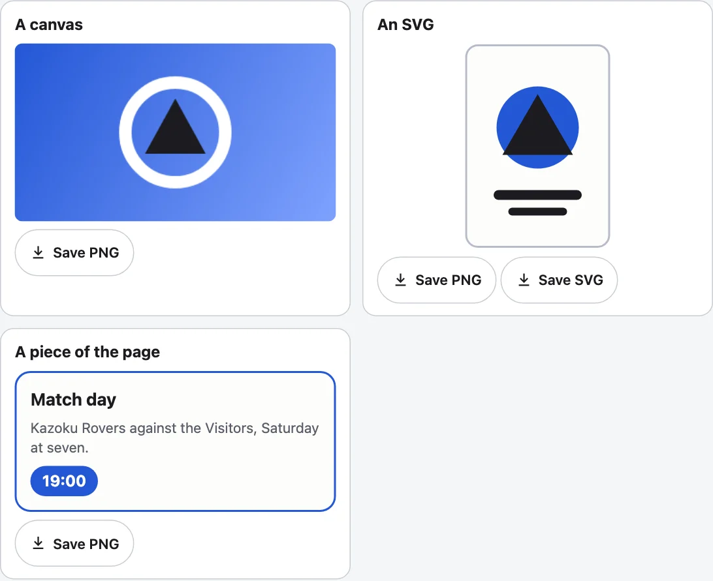

`<kazoku-save-image>` is Save PNG and Save SVG buttons for a canvas, an SVG or any element on the page. It never draws the scene: it saves what the target shows, hands the picture to the browser as a download, and tells the page with an event.



## Use it

```html
<canvas id="art" width="360" height="200"></canvas>
<kazoku-save-image for="art" name="my-picture"></kazoku-save-image>
<script type="module">
  import "@johnmorrisdotca/kazoku-ui/save-image/define";
</script>
```

| Target | Buttons | How |
|---|---|---|
| A `<canvas>` | Save PNG | The canvas' own pixels, at its own size. |
| An `<svg>` | Save PNG, Save SVG | The SVG is written out standing alone (namespaces, size, `viewBox`, and the styles it is drawn in), as SVG, or drawn as a PNG. |
| Any other element | Save PNG | Drawn through an SVG `foreignObject`, with every computed style written in. A `<canvas>` inside it is drawn in as a picture. |

## Attributes

| Attribute | |
|---|---|
| `for` | The id of the target; found in the button's own tree first. Or set `element.target = someElement`. |
| `formats` | `png svg`: which buttons, in order. One the target cannot give is left out. |
| `name` | The file name without its extension: `image` by default. Anything unsafe in a file name becomes `-`. |
| `scale` | PNG pixels for each CSS pixel of an SVG or element: 2 by default, held so that no side passes 8192 pixels and the whole stays within 36 million. A canvas is saved at its own pixel size. |
| `background` | A CSS colour painted behind a PNG. Transparent without it. |
| `manual` | Make the picture and send the event, but download nothing (the page keeps the blob). |
| `no-inline-styles` | Leave the computed styles out of what is saved. |
| `lang`, `theme` | `en` or `ja`; `light` or `dark`. |

`element.save(format?)` saves as a button would and resolves with the same detail as the event. `element.words = { png: "Download PNG" }` replaces labels. The colours are `--kazoku-ink`, `--kazoku-surface`, `--kazoku-line` and `--kazoku-accent`; the parts are `group` and `button`.

## Events

`kazoku-save` (bubbles, crosses shadow roots) is sent after the picture is made. `event.detail` has `blob`, `format` (`png` or `svg`), `width`, `height` (pixels for a PNG, CSS pixels for an SVG), `filename` and `reason` (`user` or `api`). `kazoku-saveerror` carries `{ format, error, reason }` when it could not: no target, a format the target cannot give, or the browser would not draw it. The group has a status line for a screen reader.

## What a picture of an element cannot carry

The picture is made by the browser drawing an SVG image of the element, and an image has no network and no page behind it. So web fonts are not in it (the system's fonts are used), `::before` and `::after` are not drawn, an `` is carried only as a `data:` URL (a cross-origin one is left out), and `<use href="#id">` of something outside the element is not found. Draw such a thing into a canvas and save the canvas.

## Without the element

```js
import { FORMATS, MAX_PIXELS, MAX_SIDE, MIME, filenameFor, formatsFor, parseFormats, pixelSize } from "@johnmorrisdotca/kazoku-ui/save-image";

console.log(filenameFor("My Card/../x?", "png"), "|", filenameFor("jersey", "svg"));
console.log(JSON.stringify(pixelSize(2000, 1500, 2)), MAX_SIDE, MAX_PIXELS);
console.log(parseFormats("svg png").join(" "), parseFormats("gif").join(" "), FORMATS.join(" "));
console.log(formatsFor("canvas").join(" "), "|", formatsFor("svg").join(" "), "|", JSON.stringify(MIME));
// My Card-..-x.png | jersey.svg
// {"width":4000,"height":3000,"scale":2} 8192 36000000
// svg png png svg png svg
// png | png svg | {"png":"image/png","svg":"image/svg+xml"}
```

In a page, render and download in a few lines:

```js no-run
import { downloadBlob, filenameFor, renderImage, saveImage } from "@johnmorrisdotca/kazoku-ui/save-image";

const { blob, width, height } = await renderImage(document.getElementById("art"), { format: "png", scale: 2, background: "#fff" });
downloadBlob(blob, filenameFor("my picture", "png"));
await saveImage(document.getElementById("jersey"), { format: "svg", name: "jersey" }); // both in one
```

The rest of the functions: `kindOf(target)` says what a target is (a canvas, an SVG or another element), `sizeOf(target)` its size in CSS pixels, `serializeSvg(svg)` an SVG as text that stands alone, `serializeElement(element)` any element as an SVG that draws it, and `svgToPng(text, width, height, scale, background?)` SVG text as a PNG. `ERROR_EVENT` and `EVENT` name the two events, `TAG` the tag; the labels are `WORDS` and `wordsFor`. Nothing touches the DOM at import, so the entry imports on a server.

## Strict policies

The buttons' styles are adopted as a constructable stylesheet. A canvas is saved with no request. An SVG or element is drawn through an image with a `data:` URL, so a page that sets `img-src` must allow `data:` for those two: see [Frameworks and CSP](frameworks-and-csp.md).
