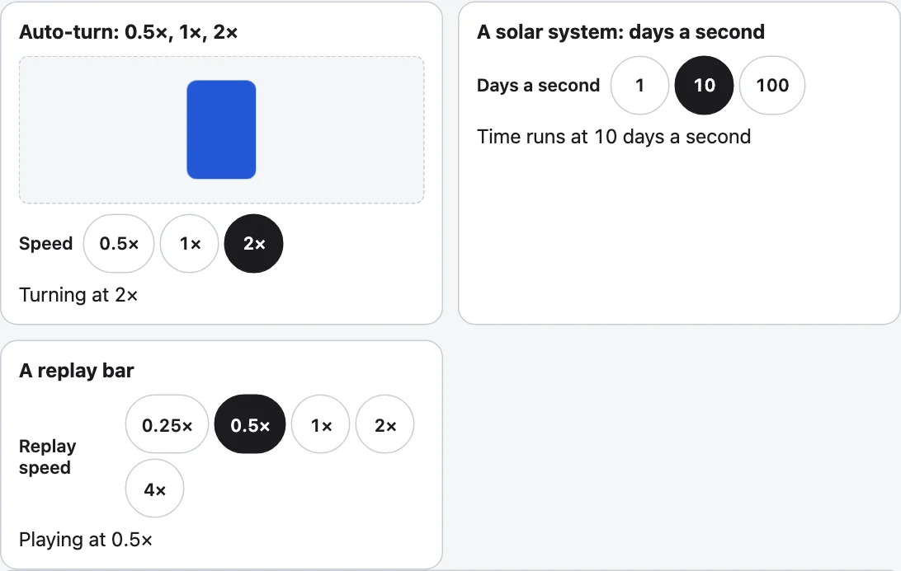

`<kazoku-speed-buttons>` is one button for each speed, side by side, with the chosen one on. There is no menu. It is the one speed control of the family: the view controls use it for Auto-turn, and a solar system's days a second or a replay bar's speeds are the same element with other steps, so a speed reads and looks the same everywhere. It moves nothing itself; the page applies the number it is told.



## Use it

```html
<kazoku-speed-buttons id="speed" steps="0.5 1 2" value="1" address></kazoku-speed-buttons>
<script type="module">
  import "@johnmorrisdotca/kazoku-ui/speed-buttons/define";
  document.getElementById("speed").addEventListener("kazoku-speedchange", ({ detail }) => {
    console.log(detail.value, detail.reason);
  });
</script>
```

| Use | Steps | Looks like |
|---|---|---|
| Auto-turn | `0.5 1 2` (the default) | 0.5×, 1×, 2× |
| A solar system's time | `1 10 100`, `unit=""`, `label="Days a second"` | 1, 10, 100 |
| A replay bar | `0.25 0.5 1 2 4` | 0.25×, 0.5×, 1×, 2×, 4× |
| A clock that can stop or run back | `0 1 3600 86400 -3600` | 0×, 1×, 3600×, 86400×, −3600× |

## Attributes

| Attribute | |
|---|---|
| `steps` | The speeds, as numbers in a list (`0.5 1 2`, or with commas). Any numbers: zero for Paused, a negative one for Back. The default is `0.5 1 2`. |
| `value` | The speed that is on. It is the start, and it follows the reader's choice, so the attribute is always true. A value that is not a step takes the nearest step. |
| `unit` | The word after each number: `×` by default; an empty one leaves the bare number. |
| `label` | The group's name, shown before the buttons and said by a screen reader. "Speed" (速さ in Japanese) by default. `no-label` hides it from the eye. |
| `address`, `address-key` | Keep the choice in the page's address under `speed`, or the key named. The start is left off, and other parameters are kept. |
| `lang`, `theme` | `en` or `ja`; `light` or `dark`. |

`element.value` reads and sets the speed; `element.steps` reads and sets the steps; `element.step(1)` goes to the next speed, round at the ends (`-1` for the one before), which is what a single button that cycles does. The colours are `--kazoku-ink`, `--kazoku-surface`, `--kazoku-line` and `--kazoku-accent`; the parts are `label`, `group` and `button`.

## The event

`kazoku-speedchange` (bubbles, crosses shadow roots) has `detail.value` (a step), `detail.steps` and `detail.reason`: `init` once when it comes up, `user` for a button or `step()`, `set` for the property or the attribute. Reduced motion changes nothing here: the buttons step as always. A page that moves things by itself decides for itself whether it moves at all.

## In the view controls

`<kazoku-view-controls>` shows the same buttons under More as the Auto-turn speed. The attribute `pace` is the speed as a multiple of `speed` (1 by default), `paces` names the buttons, and a reader's choice is written back to `pace` and kept in the address as `?pace=2`. See [View controls](view-controls.md). While the view turns with the controls at their basic level, one small button beside Auto-turn shows the speed and steps to the next one.

## Without the element

```js
import { DEFAULT_STEPS, nearestStep, parseSpeed, parseSteps, speedText, startStep, stepFrom } from "@johnmorrisdotca/kazoku-ui/speed-buttons";

console.log(parseSteps("1, 10 100").join(" "), "|", DEFAULT_STEPS.join(" "));
console.log(speedText(0.5), speedText(-3600), speedText(10, " d/s"));
console.log(nearestStep(2.5, [1, 2, 4]), startStep([10, 100]), stepFrom(2, [0.5, 1, 2]));
console.log(parseSpeed("fast", [0.5, 1, 2]), parseSpeed("nope", [0.5, 1, 2]));
// 1 10 100 | 0.5 1 2
// 0.5× −3600× 10 d/s
// 2 10 0.5
// 2 undefined
```

`parseSteps(text, fallback?)` reads a list, `speedText(value, unit?)` writes a speed as a button shows it, `nearestStep(value, steps)` finds the step nearest a value (by ratio above zero), `startStep(steps)` is 1 where there is a 1, else the first, `stepFrom(value, steps, direction?)` goes round, and `parseSpeed(text, steps)` reads an address or attribute (the words `slow`, `medium` and `fast` of the first view controls still mean 0.5, 1 and 2). `SPEED_ADDRESS_KEY`, `DEFAULT_UNIT`, `EVENT` and `TAG` are the names; the labels are `WORDS` and `wordsFor`. Nothing touches the DOM at import, so the entry imports on a server.
